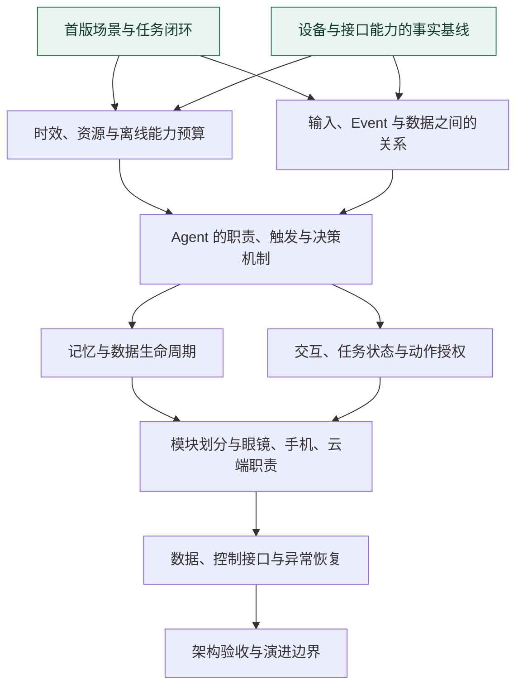

# 智能眼镜 Agent：当前前沿与依赖图

这是 [架构决策地图](map.md) 的阅读视图。更新日期：2026-10-26。状态及依赖以各决策票为准。

地图回答“架构应怎样决定”。图中的箭头表示讨论的前置依赖，具体软件模块与运行数据流由相应票解决后形成。

## 当前可开始

- **[首版场景与任务闭环](issues/01-scenarios.md)**：建议首先讨论。明确眼镜 Agent 帮谁完成哪些任务，以及什么证据表明完成。
- **[设备与接口能力的事实基线](issues/02-capability-evidence.md)**：可并行整理材料。区分设备与标签链路已经实现的能力、计划及未知项。

当前所有票均开放、未领取。本次建图已确认地图目的地和 PPT 初始约束，尚未替用户作出架构决定。

## 决策依赖

绿色节点当前可开始。其余节点在前置票解决后进入前沿；硬件未知项可在事实票中被明确记录为待验证假设，其后果由预算和架构票处理。

## 各问题会澄清什么

| 决策票 | 要得到的清晰认识 |
| --- | --- |
| [首版场景与任务闭环](issues/01-scenarios.md) | 用户任务、范围、触发与完成证据 |
| [设备与接口能力的事实基线](issues/02-capability-evidence.md) | 已实现能力、材料来源及尚待验证的假设 |
| [时效、资源与离线能力预算](issues/03-budgets.md) | 时延、功耗、带宽、存储、后台与断连要求 |
| [输入、Event 与数据之间的关系](issues/04-events.md) | 原始数据、标签、观测、指令与生活事件的含义和关联 |
| [Agent 的职责、触发与决策机制](issues/05-decision-loop.md) | 何时判断、何时行动、依赖哪些上下文及何时退出 |
| [记忆与数据生命周期](issues/06-memory.md) | 保存、关联、检索、粗化、纠错与删除规则 |
| [交互、任务状态与动作授权](issues/07-actions.md) | 用户控制、任务进度、授权、执行证据与失败行为 |
| [模块划分与眼镜、手机、云端职责](issues/08-responsibilities.md) | 模块接口、逻辑职责、部署位置与状态归属 |
| [数据、控制接口与异常恢复](issues/09-interfaces.md) | 实时/延迟链路、消息契约、补传与恢复时序 |
| [架构验收与演进边界](issues/10-validation.md) | 可验证性、版本变化及进入实现计划的条件 |

## 如何继续

下次从地图选第一张可开始的票，先领取，再围绕其问题与用户讨论。每次只解决一张人工决策票；决定完整记录在票内，地图只追加一句摘要及链接。新问题若已经能够准确提问，就创建票并标依赖；其余保留在地图的未明确区域。

沿途需要的场景流程、数据模型、模块关系和时序图由对应决策票承载。只有决定明确之后，才将它们视为已确认的架构内容。
