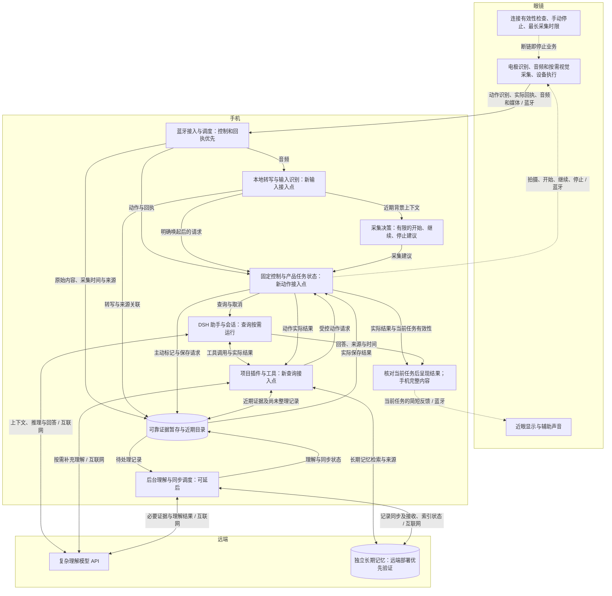
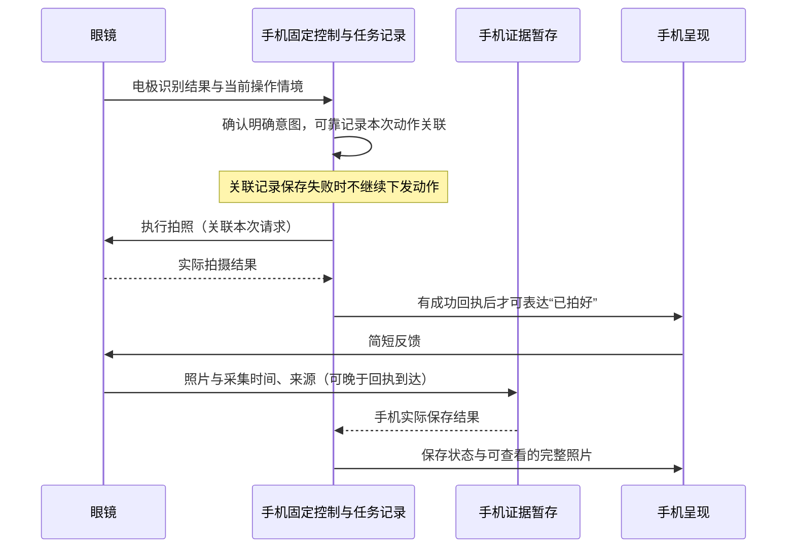
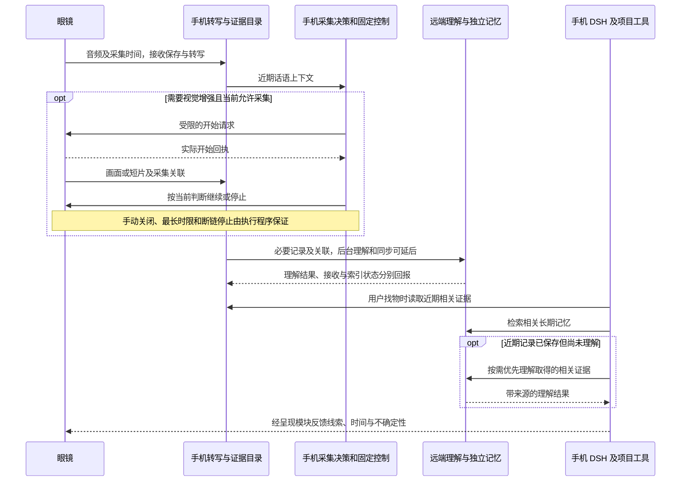
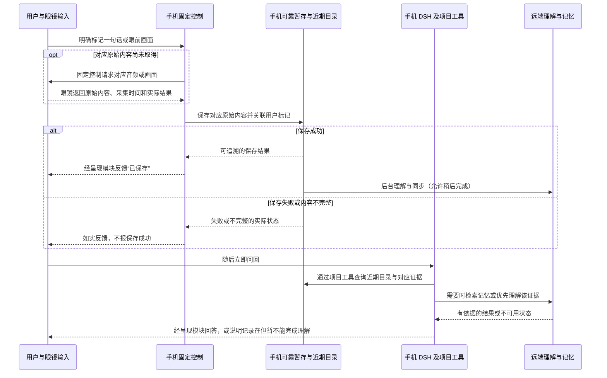
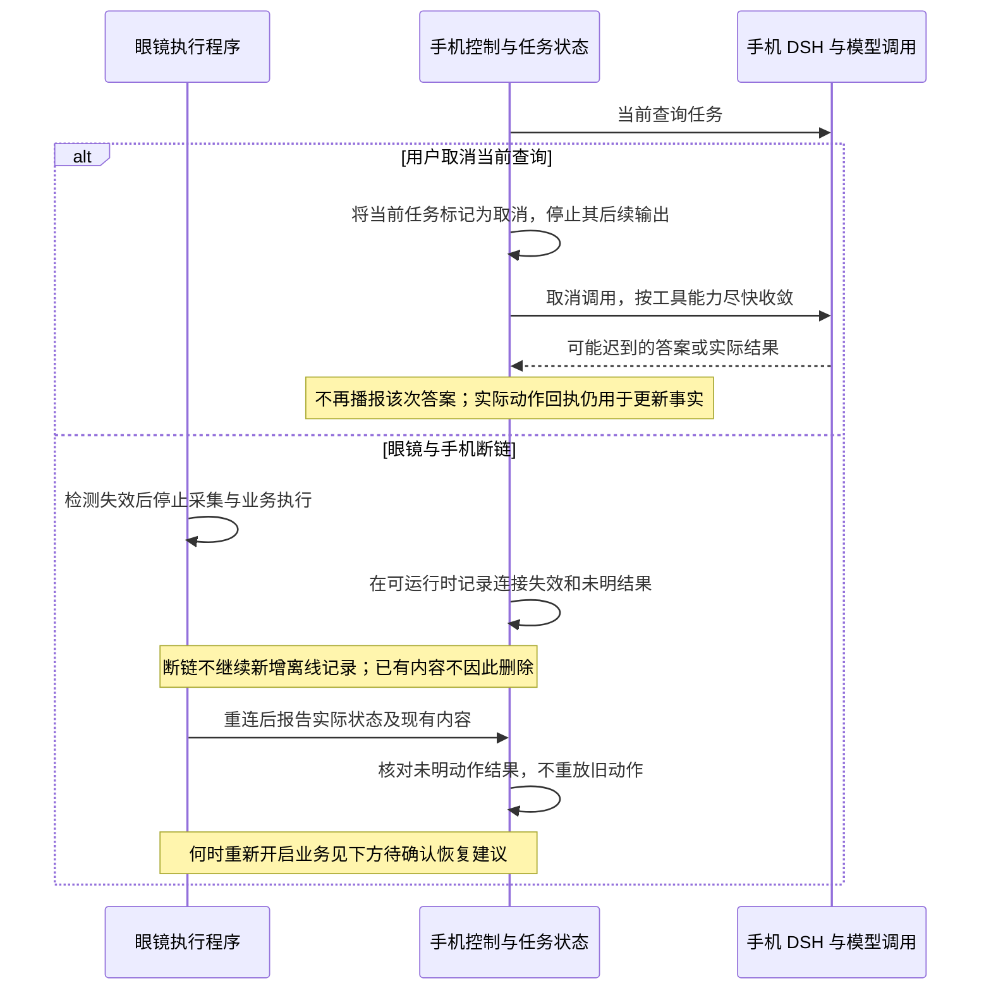

# 智能眼镜：主数据流与控制流草案

日期：2026-11-01。状态：供讨论，尚未作为整张票的最终决议。

对应决策票：[数据、控制接口与异常恢复](https://github.com/15253a/EyeX_agent/issues/10)。

依据：[模块划分与眼镜、手机、云端职责](https://github.com/15253a/EyeX_agent/issues/9#issuecomment-6557915816)、[Agent 运行时与开发框架选型](https://github.com/15253a/EyeX_agent/issues/13#issuecomment-6558586786)及本轮用户决定：“断链之后眼镜直接不工作就可以了”。

## 本轮确定的变化

眼镜与手机断链后，眼镜停止业务运行：不继续采集音频、照片或视频，不接受新的业务动作，也不为断链期间新增内容提供离线缓存。保留停止执行、连接检测和重新连接所需的底层能力；这不表示整机断电，也不删除断链前已存在的记录。固件如何识别连接失效、多久完成停止仍需验证，不声称能够瞬时发现手机进程被回收。

手机与远端断网是另一种情况：只要眼镜与手机的有效控制仍在，本地固定控制和可靠暂存沿用既定路线，远端理解与记忆访问可能受限。

## 总览

实线表示数据、请求或结果传递；虚线表示设备控制和反馈下发。眼镜与手机之间均走蓝牙；手机与远端之间走互联网。图中的模块不要求分别部署为独立进程。

控制、停止和回执优先；音频及时处理；较大媒体分块传输、可以暂停且积压有上限，同时需要验证媒体最终能够完成。连续音频不逐包送进 DSH。正常连接时的有限传输缓存，不能被解释为断链后的继续采集能力。

## 电极拍照：请求、执行与反馈

拍摄完成、照片已到手机以及远端已接收是不同事实。拍摄成功但照片仍在传输时，不能声称手机已保存或已经可以查看完整照片。动作结果未知时先核对设备，无法核实时保留未知，不因恢复会话而重新拍一次。

## 音频记忆、视觉增强与找物

查询不必等待全部后台记录整理完成。近期目录可发现尚未上传或索引的内容；查不到远端索引不等于本地没有记录。只有口述来源时表达为“你当时提到……”，不能声称视觉看到；历史线索不保证当前位置。视觉不参与时，音频记忆链路仍然成立。

## 主动标记与立即问回

可靠保存先于“已保存”反馈，保存完成不要求远端理解完成。远端不可用时仍区分“有记录，暂时无法理解”和“未取得对应记录”，不承诺完整离线问答。

## 停止、取消与恢复

用户手动关闭采集与取消查询是不同操作；取消查询不删除已有记录。已经发生的拍照不因取消变成没有发生。关闭采集、任务结束或控制失效后，迟到模型结果不能绕过当前状态重新启动摄像。

**待确认的恢复建议：** 蓝牙重连且手机控制就绪后，恢复正常业务；音频只按用户仍有效的记录开关恢复，手动关闭的记录不自动开启。未完成的交互任务结束并允许用户重新发起，不补播旧答案、不补执行旧拍照；新的自动视觉判断使用恢复后的上下文。这是草案建议，尚不将其写成用户已经确认的决定。

## 数据关联与状态责任

| 内容 | 主要责任 | 对其他模块提供什么 |
| --- | --- | --- |
| 原始证据和近期目录 | 手机可靠暂存，按策略交接长期存储 | 采集时间、设备/来源、对应原始记录及可用性；到达时间不替代采集时间 |
| 观测、事件和记忆 | 识别/理解及独立记忆 | 依据与推断分别表达；后到证据可修订推断，后来发生的变化另记 |
| 产品任务和动作状态 | 手机控制模块，结合眼镜实际回执 | 用户请求与本次动作的关联、当前取消/结束状态及已知或未知结果 |
| 助手会话 | DSH 与经过验证的持久化后端 | 对话、工具执行过程及会话恢复；不代替设备状态或原始证据保存 |
| 同步状态 | 手机同步模块和远端回执 | 手机已保存、远端已接收、已理解/索引分别记录 |

来源和时间是共同语义，不要求所有原始数据采用同一种格式。具体字段、通信协议、数据库和完整重试机制留给原型细化。

## 只保留会影响路线的异常

| 异常 | 处理方向与限制 |
| --- | --- |
| 眼镜—手机断链或有效控制失效 | 停止眼镜业务，不承诺离线采集；控制失效识别条件与停止时延待验证 |
| 手机—远端断网/变慢 | 本地控制与记录按现有资源继续；远端工作延后，复杂问答如实表达限制 |
| 蓝牙或上传持续积压 | 有限队列和背压；草案建议优先抑制新增自动视觉负载，不能靠不断增大缓存解决持续过载 |
| 手机存储不足/保存失败 | 不报告保存成功，不静默覆盖已确认保存的主动标记；草案建议暂停无法可靠保存的自动记录并显示状态 |
| 动作无回执或会话恢复 | 先核对实际结果；无法核实时保持未知，不盲目重放副作用 |
| 缺少证据 | 表达缺口和不确定性，不以未检索到记录证明事情没发生 |

## 扩展接入示例

新输入接入设备接入/输入识别，复用时间与来源、证据暂存；新动作接入固定控制与设备执行，复用关联、回执、取消和呈现；新查询经 DSH 项目插件/工具接入证据及独立记忆。

以未来的“翻译刚才那句话”为例：复用音频、转写和近期目录，新增翻译工具，结果复用近眼与手机呈现；通常不需要启动摄像，也不需要重写助手循环。增加该能力仍要评估推理调用、排队、手机耗电与数据保留。本例不把翻译加入首版范围，也不预建通用插件平台。

## 原型验证承接

Android 先贯通，同期独立验证 iOS：前台/后台/锁屏与进程回收、蓝牙音频及媒体并行、控制有效性识别和断链停止、重连实际状态核对、可靠保存与进程重启、近期未索引证据可发现、DSH 手机宿主/工具桥接/持久化，以及与本地转写并行时的资源表现。

本草案没有锁定手机宿主实现、DSH 版本或存储后端，没有承诺响应时间、续航、吞吐或全天无缺口记录。沿用 Koog 备选时保持相同的产品接口和手机主控分工。具体代表场景与判定条件由[架构验收与演进边界](https://github.com/15253a/EyeX_agent/issues/11)承接。
