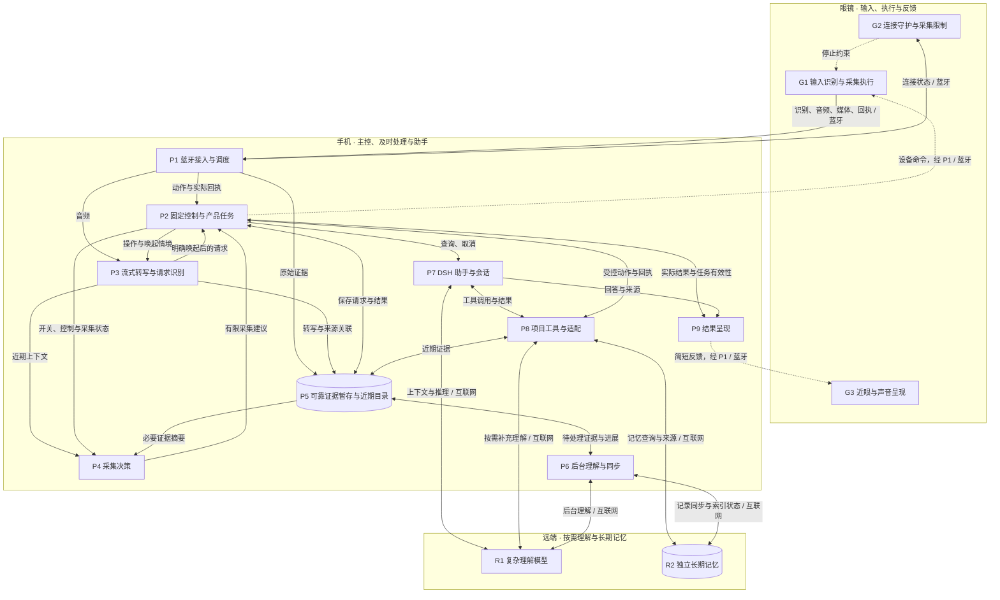

# EyeX 智能眼镜：模块级架构设计

**最新架构审阅：[三端部署、感知与 Harness、Workspace（v4）](three-end-overview.md)**。远端、手机和眼镜分区；Event 长期记忆部署暂定。下方各版保留过程参考。

**当前优先审阅：[眼镜、手机与远端的关系说明（v3）](plain-overview.md)**。先看分工和具体例子，再看[分层技术图（v2）](layered-overview.md)；下方 v1 图稿作为详细设计依据保留。

版本：2026-11-01 · 审阅稿 v1。关联决策：[架构验收与演进边界](https://github.com/15253a/EyeX_agent/issues/11)。

本稿把已确认的技术路线展开为模块级设计。用户已确认设计深度与图的组合；本稿的模块细化仍待整体走读，未表示实机、手机运行时或性能已验证。

## 阅读顺序

1. **本页：模块架构总图**——看部署、职责和主要依赖。
2. **[模块说明与接口约束](modules.md)**——看每个模块的输入输出、触发、状态和失败责任。
3. **[三条主线与关键时序](flows.md)**——看数据如何处理和保存，以及执行、反馈、取消与恢复的顺序。
4. **本页后半：技术路线、扩展走查与验证安排**——区分已经选择的方向和需要原型回答的问题。

图中的模块是逻辑职责，不要求各自运行在独立进程。模块编号在各页保持一致。泳道以运行位置划分，手机内部再标出负责处理的模块；这是一套工程数据流表达，不宣称采用严格的 BPMN 或传统 DFD 符号标准。

## 设计范围与依据

本版具体到：部署位置、职责、主要输入输出、触发方式、持有状态、失败责任、技术方向和扩展接入点。函数签名、完整字段、通信协议、数据库实现、精确时限和性能阈值留到原型细化。

三条展示主线继续是电极无手拍照、音频记忆与找物、主动标记与立即问回。近眼显示为主要简短反馈，声音辅助，手机呈现完整内容；四鼻梁电极的具体信号算法、动作映射和显示硬件能力仍依赖设备验证。

| 标记 | 含义 |
| --- | --- |
| 已决路线 | 前置决策票已确认的方向，本稿沿用 |
| 本稿细化 | 为使路线可实现而提出的模块拆分和接口语义，等待本票整体走读 |
| 待验证 | 尚未取得真机或运行证据的条件，不视作产品保证 |

前置依据：[跨端分工与音频主线](https://github.com/15253a/EyeX_agent/issues/9#issuecomment-6557915816)、[DSH 主选与 Koog 备选](https://github.com/15253a/EyeX_agent/issues/13#issuecomment-6558586786)、[主流程与断链恢复](https://github.com/15253a/EyeX_agent/issues/10#issuecomment-6558992925)。本稿细化若与前置决议出现冲突，应显式复核相应决议，不能靠绘图悄然变更。

## 模块架构总图

实线表示主要数据、请求或结果；虚线表示设备控制、停止约束或反馈下发。双向线包含请求与返回。该图保留主要依赖，完整载荷和先后关系见主线图与时序图。

### 三条主要执行路径

- **固定控制路径**：G1 → P1 → P2 → G1/G3。明确拍照、停止和操作反馈由固定程序处理，不等待远端推理，也不逐次经过 DSH。拍照命令与照片保存是两个不同阶段。
- **持续记录路径**：G1 → P1 → P3/P5 → P6 → R1/R2。接收和保存原始内容与转写可并行推进；转写/理解失败不能伪装成原始内容未曾采集，未保存的内容不能报告已保存。后台处理可延后，积压必须有界。
- **按需助手路径**：P2 → P7 ↔ P8 → P5/R2/R1。P7 组织会话和推理，P8 将产品能力接入为工具；设备副作用回到 P2，答案通过 P9 检查当前任务后呈现。记录流不逐包进入助手循环。

视觉增强是记录路径上的可选分支：P3 → P4 → P2 → G1。P4 只能提出有限的采集建议，P2 和 G2 落实用户开关、当前状态与采集限制。视觉缺失不阻断音频记忆；听懂后开相机不能取得开启前的画面。

### 两段连接与控制就绪

眼镜—手机与手机—远端分别管理。前一段失效时眼镜停止业务；后一段失效而手机控制仍有效时，本地固定控制和可靠暂存仍可按实际资源运行，远端理解及记忆访问受限。

“蓝牙已连接”只说明链路情况，不能单独证明手机控制就绪。恢复需核对设备状态、现有内容与未明动作结果，再按仍有效的用户记录开关恢复；不补执行旧命令、不补播旧答案。手机进程回收如何被固件识别、实际停止时延和宿主恢复条件均为待验证项。

## 技术路线与可替换位置

| 范围 | 已决路线／首测方向 | 替换位置与成立条件 |
| --- | --- | --- |
| 眼镜与手机连接 | 蓝牙；P1 统一调度控制、回执、音频和媒体 | 具体承载/profile 随硬件与双平台验证；不将“支持蓝牙”等同于全部音频/媒体通道可用 |
| 音频编码 | Opus 为首测候选，避免默认全天传未压缩 PCM | G1 编码与 P1/P3 解码适配；同负载比较识别质量、编码耗电和无线耗电 |
| 流式转写 | 手机本地中文 ASR 优先；sherpa-onnx 与小型流式模型是验证起点 | P3 的转写接口保持来源与时间语义；本地热耗/准确率/后台条件不成立时比较混合或远端方案 |
| 采集判断 | 及时判断优先本地，规则基线先测闭环，轻量模型可替换；Jev 为对照或复杂语义辅助候选 | P4 输出有限建议；不把模型文本直接当硬件执行命令，不锁定训练方案或具体秒数 |
| 助手框架 | 手机 DSH 主选，Koog 备选 | P7 与 P8 接口；锁定版本、插件、手机宿主与真实持久化后端后验证。切换框架不能自动把主控迁到远端 |
| 复杂理解 | R1 经模型 API 提供语义/视觉理解；提供方未选定 | P7/P8/P6 分别保留交互推理、按需补充与后台理解的调用责任，共用适配实现可在原型中决定 |
| 证据与记忆 | P5 手机可靠暂存/近期目录，R2 独立长期记忆优先远端部署 | 数据库、远端存储与迁移比例未锁定；本地保存、远端接收、理解/索引分别记录 |
| 呈现 | P9 生成当前任务的简短内容交 G3；手机保留完整内容 | 近眼显示、声音和手机呈现按能力适配；具体渲染与电极动作映射留设备原型 |

以上候选沿用已有调查与决议，未在本稿重新进行软件版本或硬件性能验证。Android 先贯通，同时验证 iOS 的限制；具体 Node/WebWorker 等手机宿主路径仍待原型选择。

## 扩展走查

以下两例只检查架构接入方式，不新增首版功能。

| 示例 | 新增／修改 | 复用 | 资源与语义检查 |
| --- | --- | --- | --- |
| 主动标记时附带可用手机位置 | 手机定位输入适配；把位置及其来源、取得时间和精度交 P5，P2 负责与标记关联 | P5 近期目录、P6 同步、P8 查询、P9 呈现 | 定位不可用不能阻止原始标记保存；只表示当时手机位置，不证明物品位置。按需定位，测等待与手机耗电，不增加眼镜硬件承诺 |
| 翻译刚才那句话 | P8 增加翻译工具及必要的 R1 调用适配 | P3 转写、P5 近期记录、P7 助手、P9/G3 呈现 | 无需新增持续摄像；测推理排队与调用成本，取消后禁止迟到答案输出，来源/可用性限制仍保留 |

若新增的是设备动作，接入 P2 和 G1 的执行能力，再由 P8 按需暴露给助手；沿用实际回执、未知结果核对和 P9 呈现。扩展优先局限在对应模块，不预先建设通用插件平台或多 Agent 编排系统。

## 原型验证安排

下表是本稿提出的推进顺序和观察依据，不是已通过的验收结果。具体设备、时长与数值阈值在运行前结合设备预算确定；先记录完整链路基线，不用单次模型推理速度替代端到端表现。

| 阶段 | 代表检查 | 必须留下的证据与路线复核条件 |
| --- | --- | --- |
| 1. 手机与设备底座 | 固定 DSH 版本/插件/宿主，跑最小模型—工具循环；P1/P2/G1 命令与回执；P5 保存及进程终止/重启；同步探查 iOS | 分开记录模拟设备与真机结果；证明真实持久化及原生桥接可行。若需要长期大改 DSH 核心或重兼容层，按相同条件评估 Koog；宿主迁移需重开前置决策 |
| 2. 三条展示闭环 | 无手拍照、只有音频的找物与视觉补充、主动标记后立即问回；插入保存失败、未上传/未索引、取消和迟到回执 | 拍摄与保存不混淆，保存失败不报成功；近期记录可发现；答案保留来源、时间和不确定性；取消不重放副作用。无法成立时定位对应模块复核 |
| 3. 并发与平台条件 | 持续音频/ASR 叠加媒体；Android/iOS 前台、后台、锁屏与回收；眼镜断链、手机断网、远端变慢与恢复 | 端到端 p50/p95、队列/积压趋势、媒体完成情况、取消与停止收敛；分别记录眼镜/手机耗电、温升和持续降速。持续过载或关键后台约束不成立时复核采集/传输/部署路线 |
| 4. 视觉增强收益 | 同负载比较本地转写与混合/远端转写、规则/轻量判断与候选模型，固定编码和无线条件 | 从足够表达目标的话语时刻测到首张可用画面；记录误开、漏开、无用录制时长与实际补证收益。收益不足时调整 P3/P4 的实现，不擅自扩大持续摄像范围 |

两个恢复测试必须分开：眼镜断链后验证停工与重连控制就绪；手机断网时验证本地保存与远端工作延后。存储满后的具体降载策略、媒体缓存清退和数值参数仍需原型比较，不能视作本稿已经逐项定案。

## 本版审阅关注点

- 模块职责是否足够清楚：尤其是 P2 产品任务、P5 证据、P7 会话、R2 长期记忆各自拥有的状态。
- 三条展示主线是否能逐步对应到具体模块、数据落点和实际反馈。
- 接口约束是否保留已定行为：断链停工、有限资源、近期可发现、如实表达保存/来源，以及取消后输出控制。
- 待验证条件是否有承接位置；若仍有改变主路线的问题，应在当前票继续明确或产生具体后续决策票。

用户本轮“可以”确认的是模块级设计深度和图型组合，不提前计作本版成稿验收。当前票保持开放，完整决定仍记录在对应票的最终决议中。
