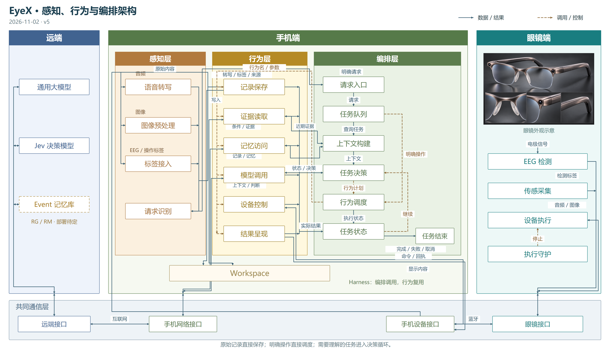
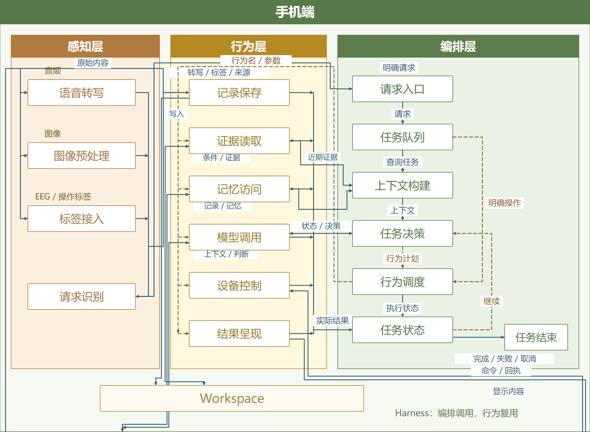

# 感知、行为与编排主图

2026-11-02 · v5 审阅稿。按本轮要求，手机端拆成三层；每个方框只保留一个名称，数据和控制含义写在箭头上。

[打开 v5 主图](behavior-view.html) · [SVG](diagrams/behavior-overview.svg) · [手机局部 SVG](diagrams/behavior-phone.svg)

## 手机三层

| 层 | 共用模块 |
| --- | --- |
| 感知层 | 语音转写、图像预处理、标签接入、请求识别 |
| 行为层 | 记录保存、证据读取、记忆访问、模型调用、设备控制、结果呈现 |
| 编排层 | 请求入口、任务队列、上下文构建、任务决策、行为调度、任务状态、任务结束 |

行为层将拍照、找物、主动标记等场景共同使用的能力分开：拍照复用设备控制与记录保存；找物复用证据读取、记忆访问、模型调用与结果呈现；主动标记复用记录保存，立即问回复用同一组查询行为。行为不是分别建立三套场景系统。

## 主要流向

1. **持续记录**：眼镜 → 设备通信 → 感知/保存 → Workspace。原始数据直接保存，转写和标签随后关联；不逐包进入任务队列。
2. **明确操作**：请求识别 → 请求入口 → 任务队列 → 行为调度 → 共用行为。明确拍照、停止等操作不等待模型决策。
3. **需要理解的任务**：任务队列 → 上下文构建 → 任务决策 → 行为调度 → 共用行为 → 任务状态。上下文通过证据读取/记忆访问取得；任务决策通过模型调用取得判断；需要继续则回到任务决策，完成、失败或取消则结束。

虚线是调用/控制；实线是数据/实际结果。行为层左侧为公共调用分发，右侧为公共结果返回，并不表示六个行为必须依次执行。模型调用、证据读取等也可被上下文/决策步骤直接调用，属于同一套共用能力。

记录保存/证据读取连接手机 Workspace；记忆访问/模型调用连接手机网络接口；设备控制/结果呈现连接手机设备接口。两段通信仍是互联网和蓝牙，手机接收的媒体不会因此被默认转发到远端。

## 保留的设计约束

三端分区、眼镜本地 EEG 检测、共同通信层和手机 Workspace 保留。EEG 状态标签不自动成为操作授权，感知侧只有明确请求进入用户任务链路。

Event 记忆库的部署位置继续待选，RG/RM 仍暂指长期记忆维护库。Workspace 与长期记忆职责不同，确认保存需要可靠存储，不能任意淘汰已确认的原始证据。

执行校验、停止守护、来源与保存依据、取消后抑制旧输出和未知结果核对仍按前置决定落实。本图省略这些模块内细节，行为调度或模型输出不代表硬件已经执行；完成输出也必须经过当前任务有效性校验。

本轮为架构表达与共用能力拆分的审阅稿，未声称新增算法、手机宿主或硬件已经验证。旧 v4 的详细说明继续作为历史依据，本版优先用于主图走读。

