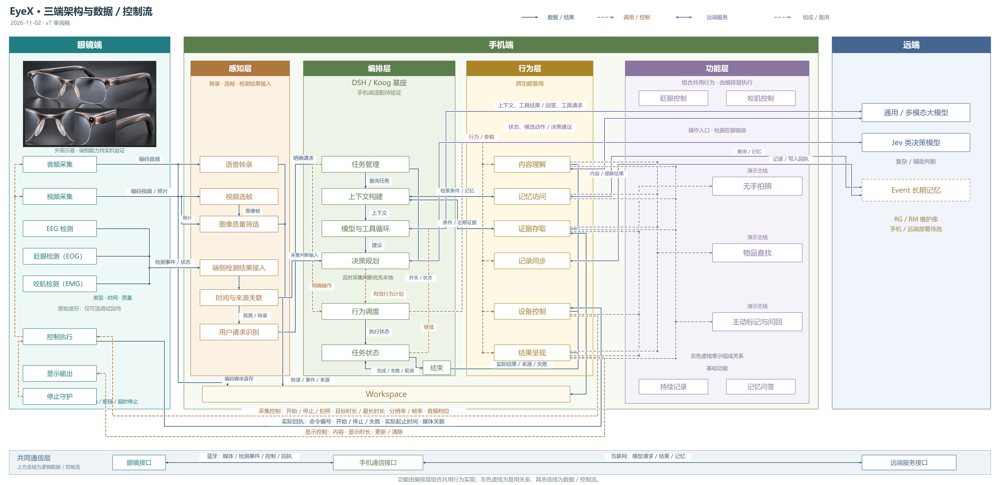
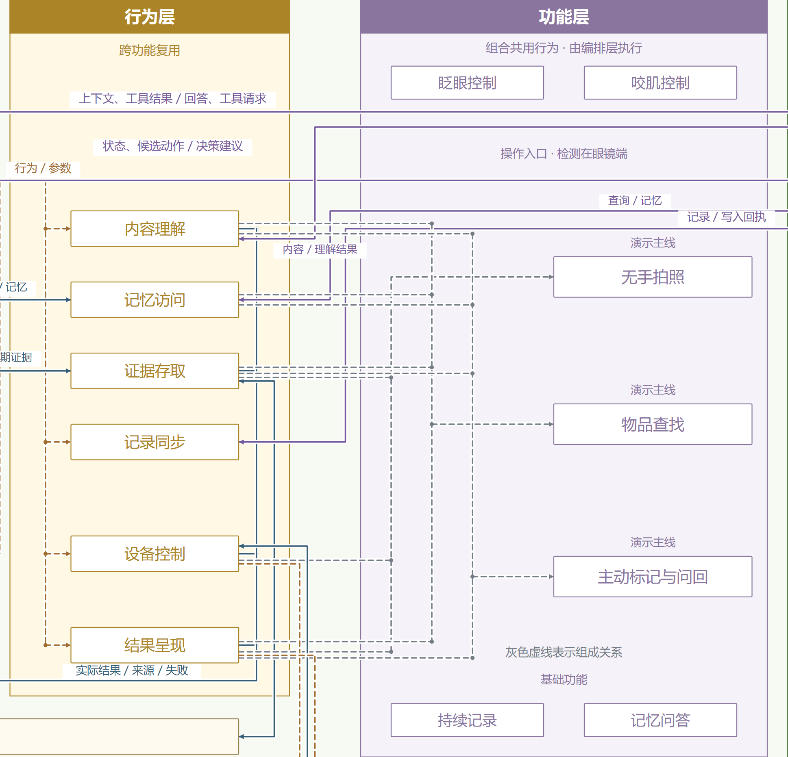

# 三端架构与功能组合

2026-11-02 · v7 审阅稿。按用户本轮修正，将功能层从顶部移到行为层右侧，展示共用行为如何组成演示功能。

[打开 v7 主图](composition-view.html) · [独立 v7 页面](composition-view.html) · [完整 SVG](diagrams/composition-overview.svg) · [完整 PNG](diagrams/composition-overview.png) · [行为与功能局部](diagrams/composition-detail.svg)

## 布局与含义

眼镜在最左，手机居中，远端在最右。手机从左到右为感知层、编排层、行为层、功能层。

功能由编排层组合调用共用行为实现。功能层是面向用户的场景表达，不新增一个必须在行为执行后运行的处理进程。灰色虚线表示“组成／复用”；蓝色数据线、橙色调用／控制线和紫色远端服务线继续表示运行时关系。

图中只为三条演示主线展开组成连线，眨眼控制、咬肌控制、持续记录和记忆问答仍保留。

## 三条演示主线

| 演示功能 | 共用行为 | 组合边界 |
| --- | --- | --- |
| 无手拍照 | 设备控制、证据存取、结果呈现 | 先控制拍摄，再保存并反馈；拍摄回执和保存结果分别确认，不以远端理解／同步作为拍照完成条件 |
| 物品查找 | 记忆访问、证据存取、内容理解、结果呈现 | 同时能读取近期音频／转录与长期线索；内容理解按需使用，不默认开启相机，不必等待后台同步全部完成 |
| 主动标记与问回 | 证据存取、记忆访问、内容理解、结果呈现 | 标记保存主要使用证据存取与呈现；后续问回按需组合检索和理解。图示为整个功能可复用的能力集合，不表示每次标记都先调用大模型 |

眨眼／咬肌控制是操作入口，检测仍在眼镜端；手机结合交互情境选择拍照、标记、取消等操作，不复制一套相同设备行为。具体动作映射尚未固定。

持续记录复用采集控制、证据存取和后台记录同步；记忆问答与找物／问回复用相同检索、理解和呈现能力。需要新照片或视频的场景可按需增加设备控制。本图没有把记录同步画成三个演示功能的必经步骤。

## 保留的接口与约束

上行编码音频／视频／照片、EEG/EOG/EMG 端侧结果及实际回执；下行采集控制参数和显示参数，均沿用 [v6 接口说明](endpoint-overview.md)。原始电极波形只保留为可选调试回传。

DSH 主选、Koog 备选，手机端适配待验证；明确操作走固定路径，及时采集判断优先本地。远端大模型接 Harness 模型与工具循环及内容理解，Jev 接决策规划，Event 记忆经记忆访问供上下文使用；功能层右移不改变这些调用位置。

Event 存储仍为手机／远端待选，RG/RM 暂指长期记忆维护库。可靠保存、任务有效性、取消及断链停止规则不变；图中设备与算法能力、参数范围均未通过本图验证。图稿继续审阅。

