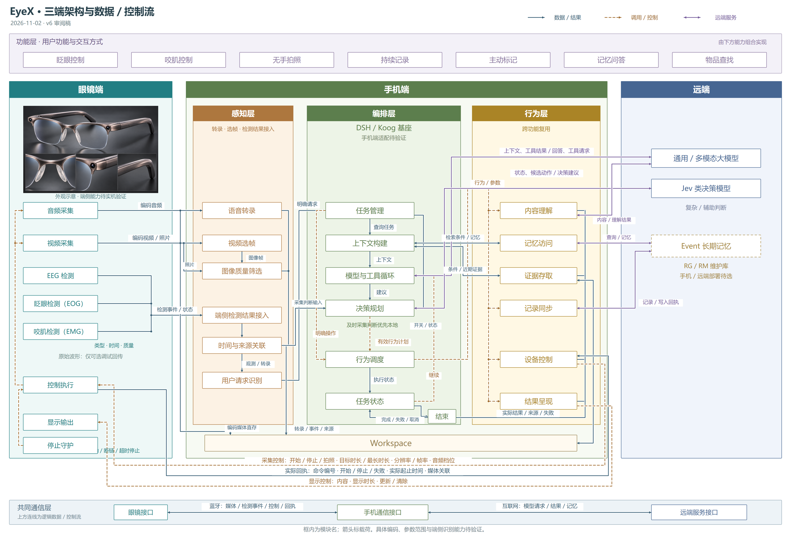

# 三端架构与数据／控制流

2026-11-02 · v6 审阅稿。根据本轮讨论重排部署、手机三层和远端服务接入；图中只写模块名，连线标主要载荷。参数名称为当前接口建议，具体取值、硬件支持范围和完整协议仍待验证。

[打开 v6 主图](endpoint-view.html) · [独立 v6 页面](endpoint-view.html) · [SVG](diagrams/endpoint-overview.svg) · [PNG](diagrams/endpoint-overview.png) · [手机局部](diagrams/endpoint-phone.svg)

## 部署与四层

- 左侧眼镜：音视频采集、EEG 检测、眨眼检测、咬肌检测、控制执行、显示和停止守护。外观图仅为概念示意；识别、显示、采集和参数控制能力尚未通过本图验证。
- 中间手机：依次为感知层、编排层、行为层。编排以 DSH 主选、Koog 备选为基座，手机宿主、持久化和原生桥接适配待验证；图中项目任务逻辑不等同于框架自带功能。
- 右侧远端：通用／多模态模型、Jev 类决策模型、Event 长期记忆。Event 画在右侧用于说明远端部署时的接口，实际位置仍是手机／远端待选；RG/RM 暂指长期记忆维护库。
- 上方功能层：眨眼控制、咬肌控制、无手拍照、持续记录、主动标记、记忆问答、物品查找。它是组合场景和交互方式视图，不是行为之后的一道执行步骤。

眨眼、咬肌的识别在眼镜端；手机结合当前唤起和任务情境，将事件解释为具体产品操作。未固定单眨、双眨、咬合等手势到功能的映射，不能把每次生理动作都视为有效命令。EEG 状态也不自动成为操作授权。

## 手机感知模块

| 模块 | 输入 → 输出 |
| --- | --- |
| 语音转录 | 编码音频 → 解码、语音活动／端点检测 → 带时间的转录文本 |
| 视频选帧 | 编码视频片段 → 解码选帧；照片直接进入图像筛选 |
| 图像质量筛选 | 图像帧／照片 → 质量状态、可用画面及重复关系；不等同于删除已经保存的原始记录 |
| 端侧检测结果接入 | EEG 状态、眨眼／咬肌检测事件 → 保留类别、时间、质量和来源的标准观测 |
| 时间与来源关联 | 音频、文字、图像、事件 → 同次采集的关联与时间范围；不宣称眼镜和手机时钟天然一致 |
| 用户请求识别 | 转录、端侧事件、当前唤起情境 → 明确操作、查询请求或待澄清信息 |

媒体和来源可以直接保存到 Workspace，不逐包进入 Harness。图中“编码媒体直存”是持续记录到可靠存储的简写，具体保存由证据存取能力承接；转录和检测结果可随后关联。近期证据可以直接读取，不必等待远端索引。

## 眼镜 → 手机

| 类别 | 建议载荷 | 处理阶段 |
| --- | --- | --- |
| 音频 | 编码帧／片段、编码格式、采样率、声道、采集时间、序号、缺失状态 | 已采集编码的媒体；不是转录文本，手机继续识别 |
| 照片／视频 | 编码照片或按需视频片段、分辨率、帧率、采集时间、采集编号、完整性 | 已编码媒体，不默认传输未压缩传感器画面 |
| 眨眼／咬肌事件 | 识别类别、发生时间、持续时间、来源、质量；算法提供时带置信度 | 端侧检测后的结果，不等于已经执行的命令 |
| EEG 结果 | 已选算法输出的状态／特征、算法标识、时间窗口、质量 | 端侧分析结果；具体检测目标尚未在本图锁定 |
| 回执／状态 | 命令编号、接收／实际开始／实际停止／失败／未知、实际时间、媒体关联、错误原因 | 设备实际执行事实，不等于手机已经保存或远端已经索引 |

原始 EEG/EOG/EMG 波形只保留为可选调试／验证通道，不默认持续上传。媒体编码与语义预处理要区分：编码音频、编码视频仍承载原始采集内容；检测标签和转录是派生结果。本图不保证持续高码率视频能通过既定蓝牙链路，编码、吞吐、积压和功耗需实测。

## 手机 → 眼镜

| 控制类别 | 建议参数 |
| --- | --- |
| 录像 | 开始／停止、目标录制时长、最长允许时长、分辨率、帧率、编码档位 |
| 音频采集 | 开始／停止、采样率、声道、编码档位、停止条件；图中统称“音频档位” |
| 拍照 | 拍照请求、分辨率、图片质量档位 |
| 显示 | 显示／更新／清除、内容、显示时长、位置或模板 |
| 检测配置 | 检测开关、识别模式、校准配置；仅在硬件与算法确实支持时提供 |

命令共用请求编号、有效任务关联和有效期限；时长等字段在协议细化时统一单位，不在图中填假定的取值。设备对不支持的参数明确拒绝或返回实际采用的配置，不能静默假定请求已落实。停止、断链停止和最长时限在眼镜本地落实；手机仍持有当前记录开关和产品任务状态。

例如“录像 5 秒”仅用于说明字段含义：手机请求开始＋目标时长＋采集档位；眼镜报告实际开始、实际结束和媒体；手机确认可靠保存后才能报告已保存。5 秒不是已选定的产品参数。掉线重连不补执行旧命令，也不补播旧答案。

## Harness 与远端服务

| 远端服务 | 手机使用位置 | 请求 → 返回 |
| --- | --- | --- |
| 通用／多模态模型 | 模型与工具循环 | 上下文、用户请求、工具结果 → 回答、工具调用请求 |
| 通用／多模态模型 | 内容理解行为 | 照片／片段及问题 → 理解结果与关联 |
| Jev 类决策模型 | 决策规划 | 当前状态、观测、候选动作 → 有限决策建议 |
| Event 长期记忆 | 记忆访问 → 上下文构建 | 检索条件 → 记忆与来源 |
| Event 长期记忆 | 记录同步 | 新增／更新记录 → 实际写入／处理状态 |

及时采集判断优先在手机本地进行：关联后的观测以及当前开关／任务状态直接进入决策规划，无需先完成远端模型循环。Jev 为复杂／辅助判断候选，建议经本地有效性判断和行为调度后执行；远端不直接控制眼镜。

明确操作从任务管理直达行为调度；查询使用上下文和模型工具循环。行为层是共用能力集合，不要求六种行为顺序执行。实际结果回到任务状态，继续则进入下一轮，完成／失败／取消则结束；呈现行为仍受当前任务有效性约束。持续记录和后台同步也可复用这些能力，不必逐次启动对话。

## 图的读法与依据

实线表示数据或实际结果，橙色虚线表示调用／控制，紫色双向线表示远端服务请求与返回。圆点表示相连的分支，交叉处没有圆点不表示合并。上方模块连线为逻辑流；共同通信层说明眼镜—手机蓝牙与手机—远端互联网两段实际路径，不增加眼镜直连远端的假设。

EEG、EOG、EMG 按来源分别命名。端侧 EOG 眼动／眨眼识别的相关研究见 [ElectraSight](https://arxiv.org/abs/2412.14848)，咬肌 EMG 测量示例见 [Colonna 等人的研究](https://pubmed.ncbi.nlm.nih.gov/38840500/)；这些资料仅支持术语和技术区分，不证明当前电极配置已具备同等能力。

本图沿用前置执行、保存、取消和断链约束。全部设计细化仍供主图审阅，未表示产品已经实现。上一稿保留于 [v5 感知、行为与编排](behavior-overview.md)。

