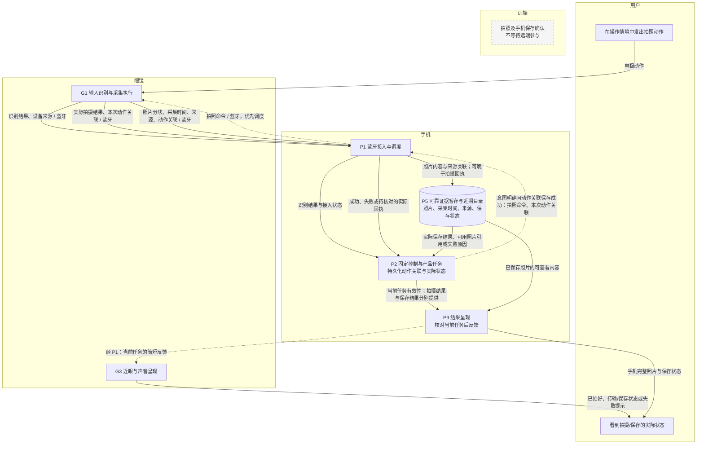
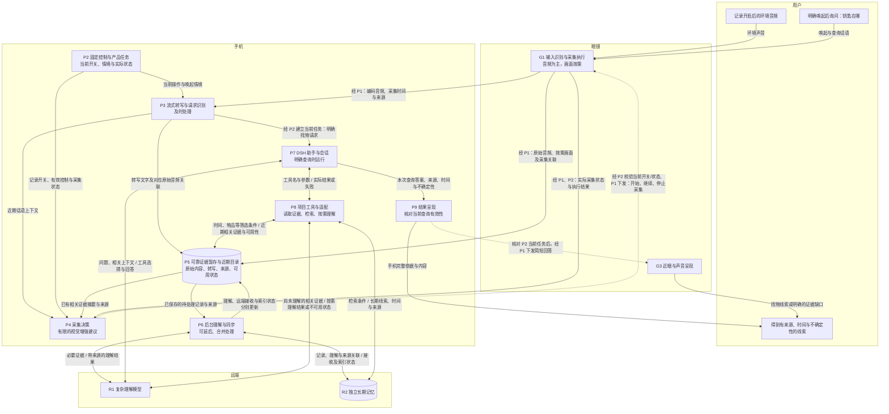
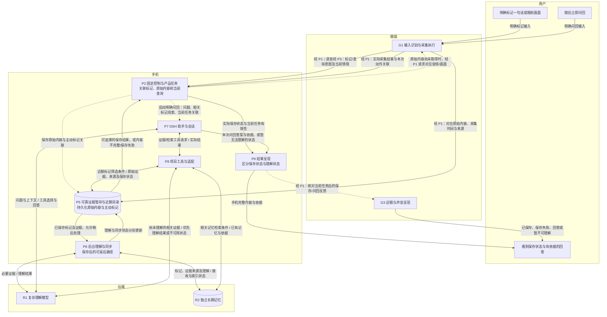
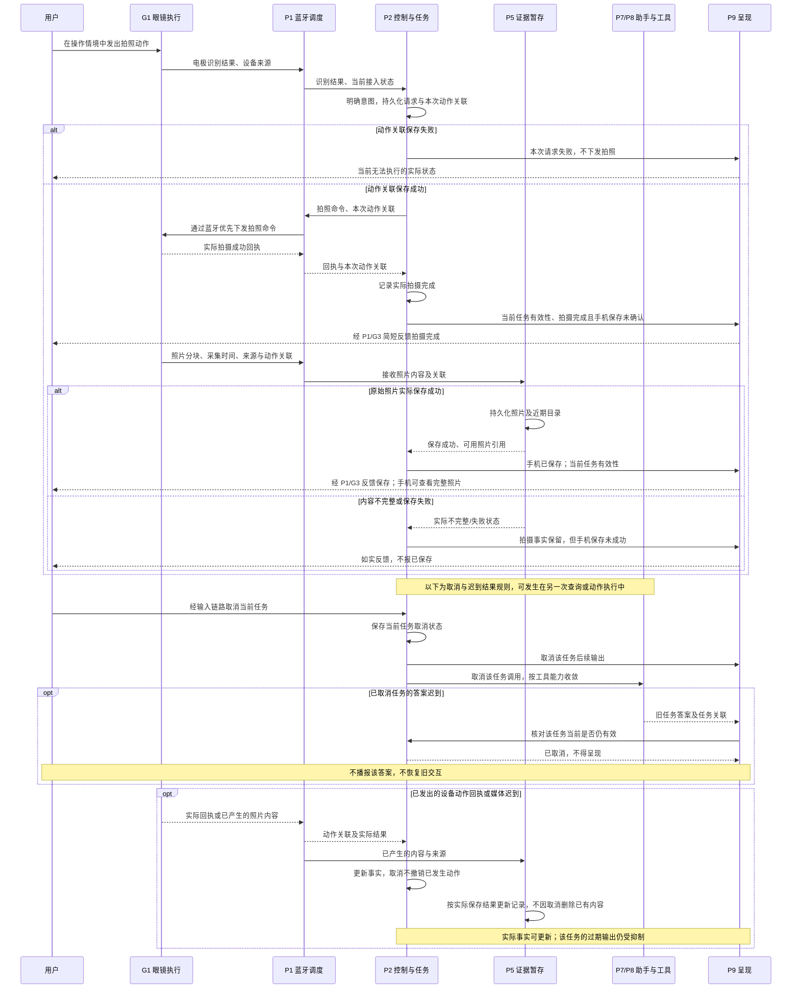
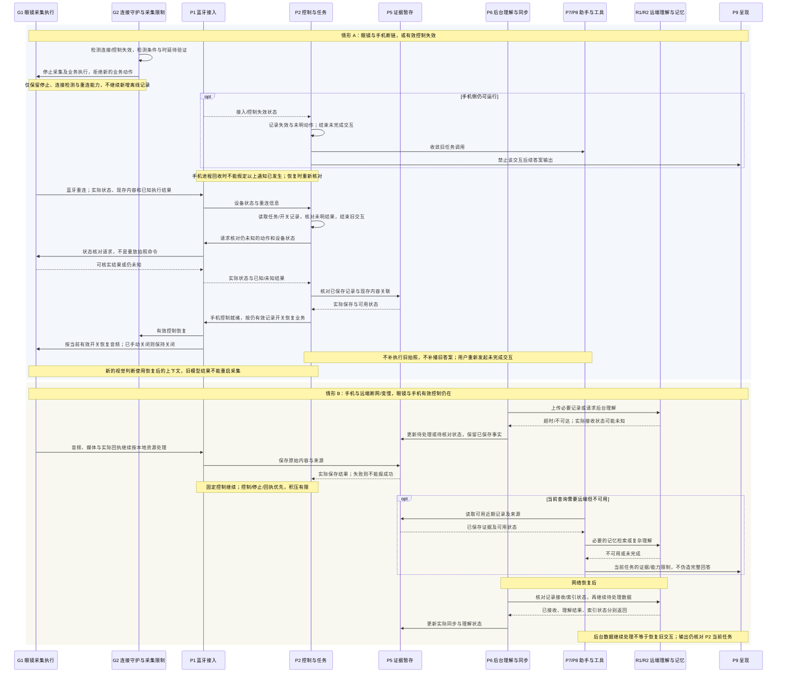

# 主线泳道数据流与关键时序

日期：2026-11-01。状态：模块级架构设计审阅稿；未进行实机或性能验收。

本稿以[既有主流程图稿](https://github.com/15253a/EyeX_agent/blob/d49d607a0eb6e96710c8168186abc7bec690ff1e/docs/architecture/data-control-flows.md)和[已确认的断链、重连决议](https://github.com/15253a/EyeX_agent/issues/10#issuecomment-6558992925)为依据，将主要数据、控制和状态责任落实到统一模块编号。图中的职责划分不要求模块分别部署为独立进程。

## 读图约定

- **泳道表示运行位置**：用户、眼镜、手机、远端。眼镜与手机走蓝牙，手机与远端走互联网。
- **数据流图的实线**表示数据、结果或用户输入；**虚线**表示执行命令、调度或呈现指令。双向实线表示请求参数与返回数据，具体载荷写在连线上。
- 图中注明“经 P1”“经 P2”等的连线是路由简写：依然经过指定模块，没有绕过蓝牙调度、任务管理或执行校验。为避免重复，部分图不再为这些中转单独画节点。
- **P2 保存产品任务及动作关联，P5 保存原始证据与近期目录，P7 保存助手会话，R2 保存长期记忆。** 它们可以使用同一类存储技术，但不是同一份事实。具体存储实现仍待原型选择与验证。
- “拍摄完成”“手机已保存”“远端已接收”“已理解/索引”分别有自己的依据。反馈不能把前一个状态当成后一个状态。
- 时序图另按通用约定使用实线调用和虚线返回；其箭头样式不套用数据流图的控制/数据区分。

## 一、电极拍照：固定控制与手机保存

P2 在下发动作前可靠保存本次请求与动作的关联，保存失败时不继续下发。G1 的拍摄成功回执可以早于照片到达，P9 此时只表达拍摄事实；只有 P5 实际保存后，才表达手机已保存或展示完整照片。远端泳道中的灰框是无依赖说明，不是新增模块。G2 的连接守护、手动停止及采集限制始终约束 G1，详见恢复时序。

## 二、音频记忆与找物：及时处理、延后整理、按需查询

图中两条路径共享 P5：记录路径在保存后由 P6 延后理解与同步；查询路径由 P7/P8 直接发现近期证据，不必等待全部后台整理。连续音频不逐包进入 DSH。P4 只提出受限采集建议，P2 结合当前开关和任务状态决定是否执行，G2 落实断链停止、手动停止和最长采集时限；迟到建议不能重新开启已关闭的采集。

音频与视觉分别保留来源。只有口述时回答“你当时提到……”，不能声称看到了物品；历史线索不能保证当前位置。P6 的失败或延后不抹去 P5 已保存事实；远端不可用时，P8 返回受限状态，P7/P9 如实表达，不能以查询不到索引推断记录不存在。

## 三、主动标记与立即问回：先保存，再理解

P2 发出保存请求不是保存成功依据；P5 确认原始内容及标记关联实际保存后，P9 才能表达“已保存”。若内容不完整或保存失败，P2/P9 保留并反馈实际状态，不让 P6 的后续工作伪装成已经可靠保存。

立即问回经过 P8 读取近期目录，可使用尚未上传或索引的内容；需要额外理解时按需调用 R1。已有记录但暂不能理解，与没有取得记录是不同结果。P7 的会话恢复不能替代 P5 的原始证据保存，P6 的后台处理也不是问回路径的统一前置条件。

## 四、关键时序：拍摄回执、照片保存与取消

图中完整照片保存可晚于拍摄回执；这一时序不是对到达顺序的固定保证。无回执时由 P2 经 P1 核对 G1 实际状态，无法核实时保留未知，不重放拍照命令。取消后的输出以 P2 当前任务状态为依据；这不会把已完成拍摄、已取得媒体或已保存记录改写成未发生。眼镜反馈路径始终经过 P1/G3，图中部分返回用户的线条作了简写。

## 五、关键时序：眼镜断链与远端断网分别恢复

G2 负责眼镜端失效后的停止，P2 负责恢复后的产品任务与控制就绪判断。蓝牙显示已连接不能单独证明控制可用；手机进程回收、后台限制、停止时延与状态核对能力仍须分别在 Android/iOS 验证。正常连接期间已有内容可以在重连后核对，不代表眼镜在断链期间继续采集。

远端中断时，P5 的可靠暂存和有限资源条件仍然适用，不能靠无限缓存维持持续过载。P6 继续处理的是待同步数据；P7/P8/P9 不因后台恢复而自动补播旧答案。具体超时、重试、去重键和满存储策略属于后续实现设计，本稿只明确状态责任和不得误报成功的原则。

## 跨图一致性检查点

1. 眼镜动作由 P2 管理并经 P1 下发，G1 返回实际回执；P4 和 P7/P8 都不能绕过 P2/G2 的当前约束。
2. P5 的证据持久化与 P2 的产品任务持久化分别负责；P7 会话保存既不替代它们，也不能证明外部动作恰好执行一次。
3. 及时路径与后台路径共享来源关联，但不互相冒充完成：P6 的接收/理解/索引结果分别回写，P8 可查询尚未完成后台整理的近期证据。
4. 主选路线是手机主控、DSH 在手机运行、手机优先本地流式转写、远端复杂理解与独立长期记忆；这些图不锁定框架版本、手机宿主、模型、数据库或蓝牙承载实现。
5. 固件、蓝牙吞吐、ASR/DSH 并行资源、Android/iOS 前后台与锁屏、真实持久化和异常恢复均保留原型验证条件。图稿完整不等于实机能力或性能已经通过。
