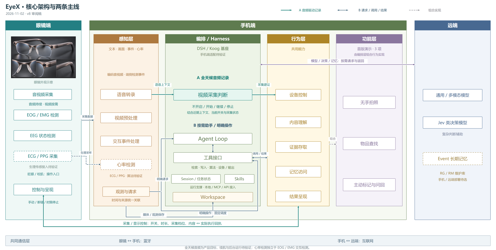

# 核心架构与两条主线

2026-11-02 · v8 审阅稿。保留眼镜—手机—远端以及手机感知、编排、行为、功能各层的位置；聚合层内能力和跨层载荷，突出持续记录与按需任务。

[打开主图](three-end-view.html) · [独立 v8 页面](focus-view.html) · [SVG](diagrams/focus-overview.svg) · [PNG](diagrams/focus-overview.png) · [手机局部](diagrams/focus-phone.svg)

## 本轮已确认

- 首版演示保留三条：**无手拍照、物品查找、主动标记与问回**。全天候音频与按需视频是共同底座，眨眼／咬肌是操作入口，不额外计为首版演示功能。
- 用户要求保留各层，修改层内内容，并以聚合节点替代逐模块交叉连线。功能由编排层组合共用行为实现，只保留一条组成关系。
- 用户澄清新增生理感知指 **ECG／PPG 心率检测**。眼镜端增加待验证的生理采样输入，手机感知层增加心率检测；EOG／EMG 继续用于交互检测，EEG 状态单列。具体传感器、信号路线、佩戴位置和算法有效性待验证。

## 四层内容

| 层 | 关键点 | 聚合接口 |
| --- | --- | --- |
| 感知 | 语音转录、视频预处理、交互事件处理、心率检测 | 带时间和来源的文字、画面、事件、心率观测，以及明确请求 |
| 编排／Harness | 视频采集判断；Agent Loop、工具接口、Session／任务状态、Skills、Workspace | 受当前开关与任务状态约束的采集建议、工具调用，以及实际返回结果 |
| 行为 | 设备控制、内容理解、证据存取、记忆访问、结果呈现 | 可复用能力、实际执行结果、失败／未知状态及来源 |
| 功能 | 无手拍照、物品查找、主动标记与问回 | 由编排层组合左侧能力完成的三条演示主线 |

连接到层边界的线表示该层的聚合接口，不表示最近的某个小框独占所有输入输出；层内小框是能力清单。功能层箭头仅表示组成关系，不增加一道必须串行执行的步骤。

## A：音频驱动的持续记录

音频持续采集并在手机转录；近期语音上下文进入本地优先的**视频采集判断**，结合已有画面、当前记录开关和采集状态，输出不开启、开始、继续或停止建议及目标时长。行为层设备控制据有效状态执行，眼镜返回实际回执和编码媒体；视频经过预处理进入记录。

音频与派生观测可以持续保存，不因没有开启视频而停止记忆，也不逐包进入 Agent Loop。采集判断是独立的轻量常驻逻辑，不要求每次等待远端模型；Jev 仅作为复杂判断辅助候选。手动停止、断链停止和最长时限继续由本地控制落实。

“全天候音频”是本轮强调的产品目标，手机后台运行、续航、吞吐和连续性仍待实机验证，不在此图承诺全天无缺口记录。

## B：按需任务

感知将明确请求交给 Agent Loop；Loop 经工具接口调用共用行为并接收结果，继续或结束。明确拍照、停止、标记等固定操作可以走工具接口的固定调度路径，不等待模型决策。

Session 管会话上下文，任务状态管当前任务、取消和执行进展；Skills 提供任务流程与规则；Workspace 提供工作上下文、近期证据入口和中间结果。这些是运行支撑，不是必须顺序经过的流水线。设备真实状态、保存事实和已取消任务仍分别维护，不能用对话记录代替。

工具按用途分为检索、写入、算法、设备／输出；本地调用、MCP、API 是接入方式。工具接口向 Agent 暴露行为层已有能力，不复制一套搜索／保存／设备实现。DSH 主选、Koog 备选，手机端宿主与适配待验证；不宣称每个方框都是框架原生功能。

图中的媒体／观测保存线代表经证据存取进入手机可靠存储。Workspace 中的工作缓存与已确认保存的证据仍有不同生命周期，不意味着所有媒体都只保存在可丢弃的会话缓存中。

## 生理数据与跨端载荷

| 输入 | 眼镜 → 手机 | 手机处理与输出 |
| --- | --- | --- |
| 音视频 | 编码音频、照片／按需视频及采集时间、序号、来源 | 音频解码、语音活动／端点检测和转录；视频选帧与图像质量筛选 |
| 交互 | EOG／EMG 端侧检测事件及时间、质量 | 结合交互情境形成明确操作或观测；不把每次眨眼／咬合都作为命令 |
| EEG | 端侧算法状态／特征及时间、质量 | 按观测接入，不自动视作操作授权 |
| 心率 | 待选 ECG／PPG 路线的采样数据及通道、采样配置、时间、质量 | 心率检测，输出对应时间窗口的心率观测与可用性；低质量或无效片段不能伪装成有效数值 |

ECG／PPG 采集和手机心率检测均用虚线框标出待验证状态。本轮增加的是感知目标和接口位置，未认定现有眼镜电极能取得所需信号，也未确定需要持续传输全部生理波形；传输范围、端侧预处理和计算分工可在验证时细化。

控制与实际回执汇成一条双向通路，具体仍区分：采集开关、目标／最长时长、分辨率／帧率／音频编码档位；显示内容、时长、更新／清除；以及对应命令编号、实际起止、失败／未知、媒体关联。字段详细含义沿用 [v6 接口说明](endpoint-overview.md)。采集完成、手机保存、远端理解／索引仍是不同事实。

远端服务合并为一条“模型／决策／记忆”的请求返回接口：大模型用于 Agent Loop 或内容理解，Jev 可辅助视频采集判断，Event 记忆经记忆访问供上下文使用并支持记录同步。合并绘图不改变使用位置。Event 部署仍为手机／远端待选，RG/RM 暂指长期记忆维护库。

既有取消、有效输出、断链停止和不补执行旧命令的约束不变。此版聚焦主图表达，详细接口和三条功能的行为复用关系分别保留在 [v6](endpoint-overview.md) 与 [v7](composition-overview.md)。
