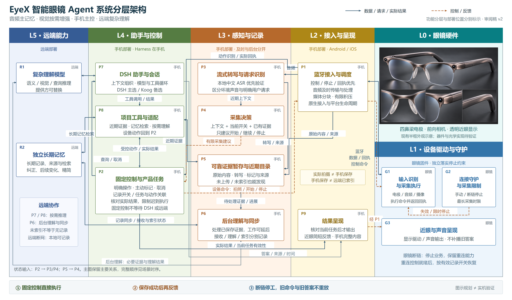

# 智能眼镜 Agent 系统分层架构主图

2026-11-01 · 审阅稿 v2。按用户提供的系统分层逻辑关系图改为横向分层版式，先集中走读这一张主图。

[可缩放 SVG 源图](diagrams/layered-overview.svg) · [离线图形阅读页](index.html) · [模块说明](modules.md) · [场景与关键时序](flows.md)

## 层次与部署

| 逻辑层 | 主要内容 | 部署 |
| --- | --- | --- |
| L5 远端能力 | R1 复杂理解模型、R2 独立长期记忆 | 远端 |
| L4 助手与控制 | P7 DSH 助手、P8 项目工具、P2 固定控制与产品任务 | 手机 |
| L3 感知与记录 | P3 转写/请求识别、P4 采集决策、P5 证据暂存/近期目录、P6 后台理解/同步 | 手机 |
| L2 接入与呈现 | P1 蓝牙接入/调度、P9 结果呈现 | 手机 |
| L1 设备驱动与守护 | G1 输入识别/采集执行、G2 连接守护/采集限制、G3 近眼/声音呈现 | 眼镜固件 |
| L0 眼镜硬件 | 既有半框外观示意与电极、摄像、显示等硬件能力方向 | 眼镜 |

分层是表达方式，不规定调用必须逐层穿透，也不要求每个模块独立部署。固定控制不等待 DSH 或远端；DSH 仍在手机。图中的连线聚焦主要关系，完整状态责任和时序继续以模块说明、场景图及已决票为依据。

实线表示数据、请求与实际结果；虚线表示执行控制、停止约束或呈现下发。P2 向 P3/P4 提供当前情境及状态、P5 向 P4 提供必要证据的辅助输入在图底部注明，避免增加重复绕线。

眼镜图片沿用项目现有 `v10-half-rim/J1-half-rim-satin-metal.png`，未重新生成或改动产品外观。它是外观概念，不能证明器件布置、光学、功耗或固件能力已验证。主图未改变前置技术路线，当前只收敛主图的结构和表达。
