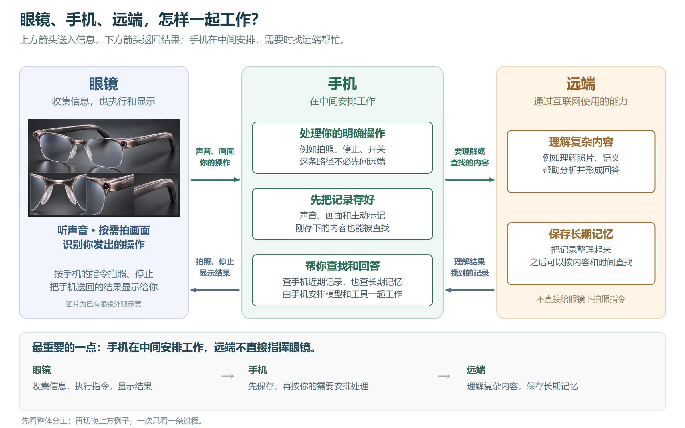
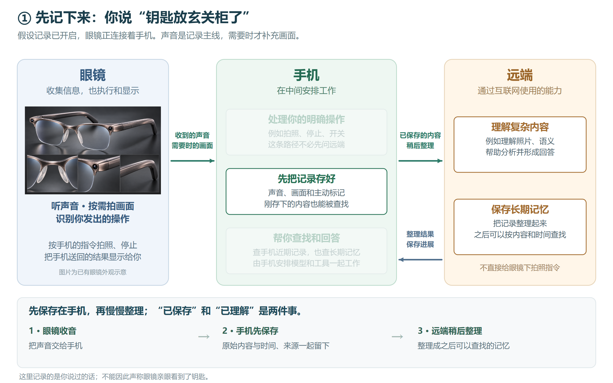
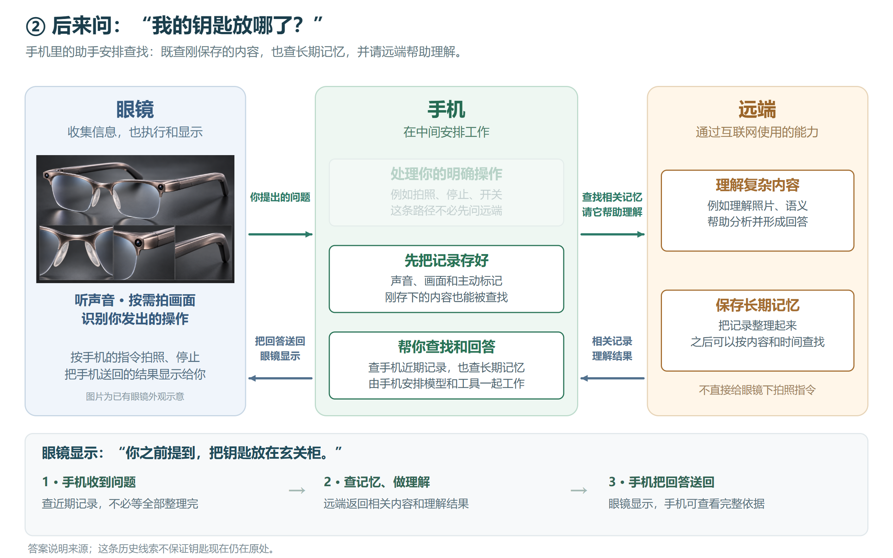
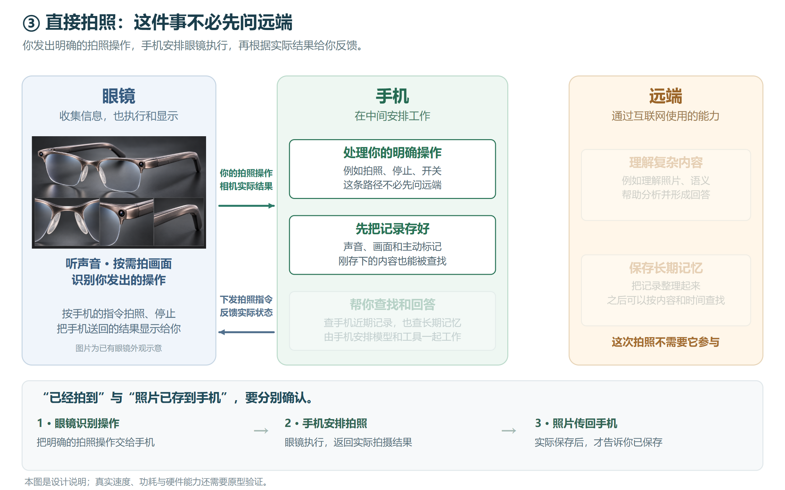

# 先看关系：眼镜、手机与远端

2026-11-01 · 易读版审阅稿 v3。用户指出分层技术图不够清晰，要求不懂技术的人也能看懂关系。本版先说明角色与信息往返，再用具体例子讲过程。

[打开可切换的图形说明](index.html) · [原分层技术图](layered-overview.md) · [完整模块说明](modules.md)

眼镜收集声音和按需画面，识别操作，也执行手机指令、显示结果。手机在中间保存记录并安排操作、查找与回答。远端通过互联网提供复杂理解与长期记忆，不能绕过手机直接控制眼镜。

## 先留下记录

前提是记录已开启、眼镜正连接手机。你说“钥匙放玄关柜了”，眼镜收音交给手机；手机先保存原始内容、时间和来源，必要的理解与长期整理可以稍后完成。

## 后来提出问题

你问“钥匙在哪”，手机安排查找近期记录和长期记忆，并请远端帮助理解；手机把答案送回眼镜。回答表达为“你之前提到……”，不把听到的口述说成视觉证据，也不保证物品现在仍在原处。

## 直接拍照

明确拍照操作经手机固定控制交给眼镜执行，不必先等远端推理。实际拍摄结果与照片保存结果分别确认，不能把已发命令当作已完成。

本轮简化表达，未改变技术路线。模块编号、框架名称与完整状态责任保留在详细设计中；外观图仍是现有概念，实机能力尚需验证。
