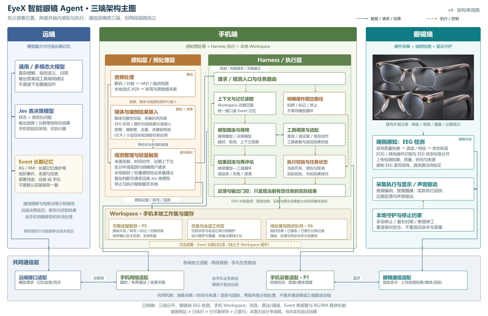

# 三端架构主图：端内感知、Harness 与 Workspace

2026-11-01 · 审阅稿 v4。按本轮用户指示分开远端、手机、眼镜三个部署区域；功能层在各端内部展开，通信层由三端各自实现适配。

[放大与全屏查看](three-end-view.html) · [SVG 源图](diagrams/three-end-overview.svg) · [PNG](diagrams/three-end-overview.png)

## 本轮已经明确与仍属建议的部分

用户明确：三端分开；感知可以在眼镜端，EEG 检测放眼镜端；手机展开感知/预处理与 Harness/执行逻辑；手机必须有缓存性质的 Workspace；远端分列通用大模型、Jev 类决策模型和暂定 Event 记忆。RG/RM 暂时理解为长期记忆维护库，不展开各自全称或内部机制。

Event 记忆存储位置重新保留为**远端或手机待选**，取代旧稿将远端作为唯一图示落点的表达。图中先画在远端并使用虚线边框，手机 Workspace 也标出可选本地部署；这不是双主并写、全量镜像或已经选定数据库。

本稿提出的算法清单、Harness 内部逻辑拆分和 Workspace 分区是供讨论的具体设计。现有 DSH 主选、Koog 备选不变；不把这些框视为已经存在的框架类或全部由 DSH 默认实现的功能。

## 手机感知与预处理：具体运行什么

| 处理 | 输入 → 输出 | 建议运行条件与责任 |
| --- | --- | --- |
| 音频解码、分帧、VAD、端点检测 | 编码音频与采集时间 → 可处理帧、语音片段、片段边界 | 基础链路。VAD 调度转写，不擅自把所有非语音原始记录丢弃；保留来源与缺口 |
| 本地流式 ASR | 语音片段 → 增量/稳定转写及原音频关联 | 手机主选验证路线；本地准确率、热耗和后台表现仍待验证 |
| 眼镜端检测结果接入 | EEG 状态标签、另行定义的操作识别、时间/质量 → 带类型的观测或请求候选 | 手机结合当前情境处理，不默认重跑一遍 EEG 算法；EEG 标签不直接等同用户授权 |
| 媒体完整性与来源校验 | 照片/短片、采集关联 → 可用内容、不完整状态、缩略预览和证据引用 | 基础处理；接收完整不等于已完成语义理解，只有可靠保存后才能报告保存成功 |
| 观测整理与轻量采集触发 | 转写、端侧标签、当前开关、已有证据 → 观测、明确请求或有限采集建议 | 本地规则/轻量模型作为及时路径；环境观察和用户请求分开，执行仍过任务控制 |
| 降噪、说话人区分、关键词或轻量意图检测 | 特定噪声/多人/交互输入 → 改善的输入或候选标记 | 按需候选，先证明收益和额外资源成本；关键词命中不能自动授权任意动作 |
| 清晰度、去重、关键帧筛选；OCR/小型目标检测 | 少量画面或任务选中的帧 → 质量、文字、目标候选 | 按任务启用；不默认全量视频逐帧分析或常驻手机大视觉模型 |

本地音频能力的工程候选继续使用 sherpa-onnx；其官方文档提供 Android/iOS、本地语音识别、VAD 和关键词等能力入口，但这些能力的存在不代表本设备组合已满足时延与功耗目标。[官方文档](https://k2-fsa.github.io/sherpa/onnx/index.html)

## Harness / 执行层：展开的主要逻辑

1. **入口和任务路由**：接收明确请求、取消、观测与采集建议。背景观测先进入记录或有限判断，不自动开启完整模型循环。
2. **准备上下文**：按当前任务读取 Workspace 近期证据，通过统一记忆接口读取 Event 记忆；保留来源和可用性，限制携带的无关数据。
3. **模型路由与调用**：复杂语义、视觉、问答交通用模型；有限状态判断可交 Jev 类决策模型。网络调用统一经过手机网络适配。
4. **工具调度与适配**：将检索、读取证据、受控动作接成工具；校验参数和返回状态，错误如实回到当前任务。
5. **执行校验与任务状态**：设备动作检查当前开关、权限、取消及限制；经手机设备适配发送，依据实际回执更新结果，未知结果先核对。
6. **结果回流与再评估**：工具结果进入必要上下文，决定继续模型—工具循环、澄清、失败或结束；有限重试与调用取消不等于撤销已发生的动作。
7. **反馈门控**：实际结果与当前任务有效性共同决定输出；已取消任务的迟到答案不再呈现，设备实际回执仍更新事实。

明确拍照、标记保存、手动停止等走旁边的固定路径，仍使用相同的执行校验、可靠保存和回执责任。固定控制、原始证据、设备桥接是项目模块，DSH 负责可复用的助手循环与会话能力。模型调用和停止控制不串成“必须先问模型才能停止”的依赖。

Jev 官方定义的重点是：对状态提出类型化问题，返回软件可使用的结构化判断；本稿据此把它与生成式理解模型分框。采用它的结果不自动赋予硬件控制权限。[Jev 官方介绍](https://docs.typesafe.ai/introduction)

沿用已确认的主选验证路线：“及时采集判断优先本地”；本地具体规则/模型仍待选，远端 Jev 承担需要它的复杂判断/辅助决策。若之后改成视觉触发主要依赖远端，需专门比较网络往返、断网与迟到结果，不把此次画在远端解释为已经确认所有触发迁移远端。

## 眼镜端的感知与执行

EEG 检测按用户要求画在眼镜本地：信号质量检查、必要滤波/特征处理，生成带时间、质量和来源的状态标签。具体算法、通道、目标状态与阈值尚未选定；不依据普通 EEG 直接承诺完整心理状态识别。

已有 PPT 依据区分 EEG 与 EOG，以及 EEG 标签与眼动控制指令。本图保持这个区分：EOG/其他操作识别不合并成“EEG 检测就是眨眼命令”。原始 EEG 是否持续回传另行决定，不默认全部上传。

采集执行、显示/声音驱动与连接守护仍在眼镜。守护直接约束执行：手动停止、最长采集时限和断链停工不依赖远端模型。眼镜图沿用既有半框外观概念，不是硬件实现证明。

## Workspace 与 Event 记忆的关系

Workspace 是手机当前任务和近期数据的工作集，至少分清三类责任：

- **可靠证据暂存**：原始片段、转写、主动标记、来源和近期目录。已向用户确认保存的内容必须有持久保存依据，不能当作任意可淘汰缓存。
- **任务与会话工作区**：当前上下文、工具中间结果和运行缓存；产品任务事实与助手会话记录分别维护。需要恢复的事实/checkpoint 持久化，纯运行缓存可重建。
- **待处理与同步队列**：待理解、待上传、远端已接收、已索引和结果未知分别记录；后台工作可延后且积压有界。

Event 长期记忆通过统一逻辑接口访问；RG/RM 暂指维护该长期记忆的库。最终部署在手机时，仍应与 Workspace 的缓存/暂存责任分开；最终部署在远端时，Workspace 仍支持近期未同步内容的发现。暂不指定复制拓扑、检索结构、保留参数或 RG/RM 内部组织方式。

## 共同通信层的含义

这是一条跨三端的逻辑带，里面有四个独立适配端：远端接口、手机网络、手机设备、眼镜通信。远端—手机经互联网，手机—眼镜经蓝牙；手机业务负责连接两段，眼镜不越过手机直接调用远端。

共同约定是消息关联、时间/来源、执行或接收回执、有限流控与失败表达；并不意味着同一传输协议、共享内存或一个共享进程。两段断连和恢复分别处理：眼镜控制失效则停工，只有远端断网时手机本地固定控制和可靠暂存仍按可用资源继续。

## 走读状态

本稿落实用户本轮结构修正，并明确保留算法与 Event 库部署待选项。旧 v1/v2 的图和模块说明保留作过程参考，涉及本轮变更时以本主图及本说明为当前审阅依据；未声称当前图已最终验收或实机验证通过。
