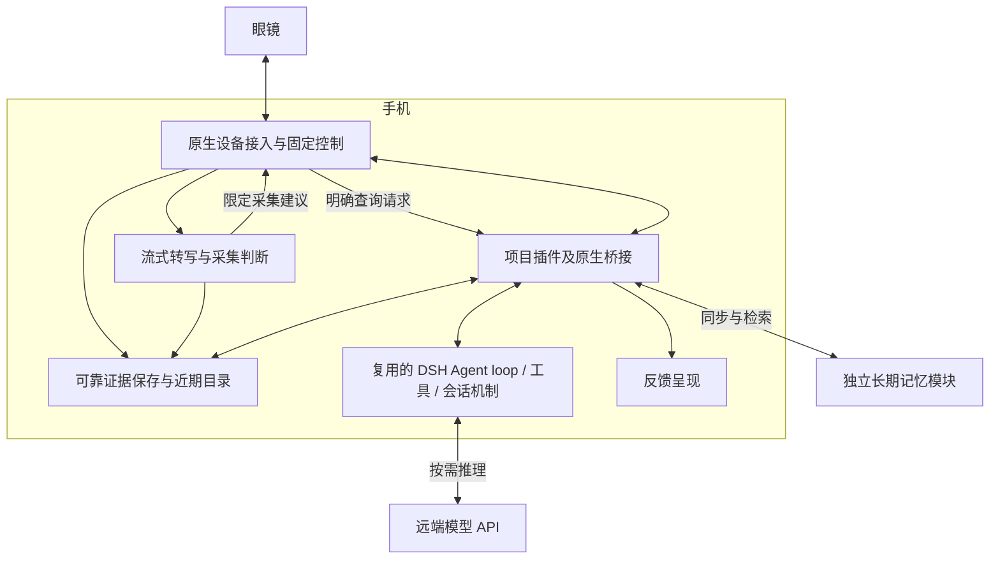

# 智能眼镜 Agent：DSH 内核复用、手机宿主与框架对照深度调查

调查日期：2026-11-01（Asia/Shanghai）。对应人工决策票：[Agent 运行时与开发框架选型](https://github.com/15253a/EyeX_agent/issues/13)。本报告是事实调查和路线建议，不是用户已确认的选型决议。

## 结论与适用范围

**优先复用已有 Agent 内核有充分理由。DSH 已有值得复用的循环、工具、会话、取消和恢复机制；“有限自建”仍要自行承担这些机制的正确性，不能仅因手机适配尚未证明就认为重写更划算。**

DSH 与本项目的功能结构相符，但手机宿主仍有明确工程缺口。当前更有依据的选择顺序是：先核验 DSH 的最小手机运行组合，同时用具有明确移动端目标的 Koog 作针对性对照；保留 AgentScope/Eino 作为有相应语言或后端需求时的候选。暂不建议重写通用循环，也不因某框架服务端部署方便而改变已定手机 Harness 分工。

以下“支持”“实现”“测试覆盖”分别指公开文档、源码机制和测试代码表达的范围。本轮完成文档、固定版本源码、依赖、测试断言与发布元数据检查；没有安装运行框架，没有执行上游测试，没有在 Android/iOS、眼镜或目标蓝牙链路上实测。不能据此承诺功耗、延迟、续航、后台常驻或生产稳定性。

## 约束和判断方法

- 眼镜负责电极识别、采集执行和反馈；手机负责主控、及时处理与 Harness；复杂理解调用远端 API，长期记忆为独立模块。
- 音频主记忆、视觉按需增强。固定操作、停止、证据落盘和连续采集不依赖一次模型推理成功。
- Android 先贯通，同时覆盖 iOS 接入与后台约束。不能用手机浏览远端 Web UI 作为“循环在手机运行”的证据。
- 比较重点是能复用的机制、实际宿主依赖、扩展接入位置和验证代价；不以功能数量、语言标签或“多 Agent”能力直接排名。
- 用户提出框架复用偏好；具体采用 DSH、采用哪个版本及宿主方式仍待确认。

既定路线以[模块划分与眼镜、手机、云端职责决议](https://github.com/15253a/EyeX_agent/issues/9#issuecomment-6557915816)为准。

## 版本基线：不能混用默认发行包与主分支能力

| 调查对象 | 固定版本 / commit | 本轮核实的区别 |
| --- | --- | --- |
| DSH 源码深审基线 | `ce7073d51254c26cd63b22a60835b8f948deb447`，提交时间 2026-10-29T16:13:15Z | 2026-11-01 查询到的 master；不是“最新稳定版”的同义词 |
| npm `latest` / `next` | `0.2.1-rc.5`；tag 对应 `b830ec950faba0a46dda564be3e2d854afed94f1` | 仓库 engines 为 `^22.19.0 || >=24.0.0`；该 tag 的 sdk-minimal 配方未挂载 `session-checkpoint-policy` |
| npm `alpha` | `0.2.2-alpha.2`；tag 对应 `f3803c96974ad4a94195fb97e5c637e9c2a3afe3` | 仓库 engines 为 `>=24.9.0`；sdk-minimal 挂载 checkpoint-policy，发布说明明确请求模型/执行工具前保存恢复记录，失败则不继续 |

默认标签来自本轮查询的 [npm 官方 registry](https://registry.npmjs.org/@deepseek-ai%2Fdsh)。发布信息见 [rc.5](https://github.com/deepseek-ai/deepseek-harness/releases/tag/dsh-v0.2.1-rc.5) 和 [alpha.2](https://github.com/deepseek-ai/deepseek-harness/releases/tag/dsh-v0.2.2-alpha.2)。engines 与组合差别分别核查 [rc.5 package.json](https://github.com/deepseek-ai/deepseek-harness/blob/b830ec950faba0a46dda564be3e2d854afed94f1/package.json)、[rc.5 minimal 配方](https://github.com/deepseek-ai/deepseek-harness/blob/b830ec950faba0a46dda564be3e2d854afed94f1/packages/bundle/sdk-minimal/cordis.patch.yml)、[alpha.2 package.json](https://github.com/deepseek-ai/deepseek-harness/blob/f3803c96974ad4a94195fb97e5c637e9c2a3afe3/package.json)及[alpha.2 minimal 配方](https://github.com/deepseek-ai/deepseek-harness/blob/f3803c96974ad4a94195fb97e5c637e9c2a3afe3/packages/bundle/sdk-minimal/cordis.patch.yml)。

“rc.5 配方未挂载某策略”只描述实际检查到的组合，不能泛化成该版本所有组合均不保存数据。后续验证必须锁定框架、插件、持久化实现和宿主的完整版本集合。

官方仍标注 developer preview，并提示破坏性更新；alpha.2 发布说明中也有投影、工具激活、模型选择及取消结果等迁移事项。可复用实现并不自动等于稳定的产品契约。相关事实应转化为锁版本、回归场景和升级预算，而不是直接否决框架。[预览声明](https://github.com/deepseek-ai/deepseek-harness/blob/ce7073d51254c26cd63b22a60835b8f948deb447/README.md)

## 推荐的产品组合（设计推断，非已实现）

图中的“插件”是接入和组织方式，不要求把蓝牙驱动、音频处理或数据库都迁入 JavaScript。原生模块通过窄接口提供能力，插件完成调用关联、上下文组织与工具接入。图中各模块并不要求独立进程。

| 能力 | 复用框架的部分 | 项目需实现/决定的部分 |
| --- | --- | --- |
| 找物与问回 | 模型—工具循环、工具参数/结果通道、会话上下文 | 检索近期和长期证据；返回来源、时间、证据类型与不确定性；未整理材料可按需理解 |
| 主动标记 | 助手按需读取已保存的标记及关联证据 | 固定控制路径先可靠保存标记与原始证据；关联对象、采集时间与片段；上传/索引状态独立于对话成功 |
| 拍摄与停止 | 查询中所需的受控设备工具可挂入框架 | 固定输入直接控制；设备命令身份、回执、停止与实际结果核对；未知结果不能直接重拍 |
| 记录与整理 | 可复用后台组织和按需调用机制 | 连续音频/ASR的节奏、合并处理、优先级、背压；不为每个音频包启动一轮 Agent |
| 恢复 | 会话日志、checkpoint、工具结果归并等现成机制 | 原生持久化契约、设备副作用核对、取消后的迟到结果、证据与任务状态的关联 |

工具名如 `search_evidence`、`lookup_memory`、`capture_image` 仅可作为后续接口设计示意，不是已存在的 DSH 眼镜工具。环境音频观测和直接用户请求继续区分；模型可见的证据不能自动成为任意设备操作授权。

这里至少有三类存储，各自承担不同责任：DSH 会话用于重建模型交互；产品任务记录用于判断执行、取消及实际结果；证据与记忆用于保存经历及其来源。可共享底层存储，但不能用一份聊天日志替代全部产品事实。

## DSH 内核、恢复与设备扩展：固定源码审阅

审阅日期：2026-11-01。下文全部源码定位于 `master` 的 `ce7073d51254c26cd63b22a60835b8f948deb447`，提交时间为 2026-10-29 16:13:15 UTC。它是本次审阅的开发线快照，**不等同于按发布日期最新的 `dsh-v0.2.1-rc.5`**，也不证明某个已发布包具有相同配置。本文只下载和阅读源码、测试；未安装框架、未运行测试或模型，未验证 Android/iOS。

### 1. 可复用的循环已经超出“手动调用 LLM”

**源码事实。** 输入区分 `followup`（下一轮并唤醒）、`steer`（下一步并唤醒）、`inject`（下一步上下文、不唤醒）。同一 Agent 以 running/idle 状态保持一个 driver；`whenIdle()` 等待当前活动及期间接续的活动收敛。[输入与驱动](https://github.com/deepseek-ai/deepseek-harness/blob/ce7073d51254c26cd63b22a60835b8f948deb447/packages/core/agent-loop/src/agent.ts#L170-L257)

每步先固定模型路由、解析本步可用工具并组装上下文，经 `agent/pre-step` 钩子批准后才进入；模型流完成后写入 assistant 消息，筛出工具调用交给 executor，收集附加上下文，再决定是否继续。失败会留下结构化 `turn/end`，普通错误和取消在 driver 边界收束。[步准入](https://github.com/deepseek-ai/deepseek-harness/blob/ce7073d51254c26cd63b22a60835b8f948deb447/packages/core/agent-loop/src/agent.ts#L283-L317)、[工具续轮](https://github.com/deepseek-ai/deepseek-harness/blob/ce7073d51254c26cd63b22a60835b8f948deb447/packages/core/agent-loop/src/agent.ts#L566-L603)、[失败边界](https://github.com/deepseek-ai/deepseek-harness/blob/ce7073d51254c26cd63b22a60835b8f948deb447/packages/core/agent-loop/src/agent.ts#L402-L425)

**工程推断。** 眼镜助手值得优先复用这些生命周期和记录机制。`idle` 只意味着停止活动，不能直接显示“任务成功”；应用还要检查结束原因与设备实际回执。复用核心并不要求把每个音频包都送进模型循环，后台采集可由独立服务运行，只在查询或需要理解时提交上下文。

### 2. 工具并发、取消与重试有边界

**源码事实。** 只有工具的 `isConcurrencySafe(args)` 返回严格的 `true` 才允许并发；未声明、抛错等情况均按独占处理。执行器使用有上限的并行池，独占工具形成屏障，结果按模型给定顺序写回；取消后停止补充新调用并等待已开始调用结束。[并发准入](https://github.com/deepseek-ai/deepseek-harness/blob/ce7073d51254c26cd63b22a60835b8f948deb447/packages/core/tools/src/pipeline.ts#L98-L113)、[调度与收敛](https://github.com/deepseek-ai/deepseek-harness/blob/ce7073d51254c26cd63b22a60835b8f948deb447/packages/core/tools/src/batch.ts#L186-L233)

`cancel()` 默认清空待处理输入并触发 AbortSignal；**取消是协作式的**。执行管线仍 `await tool.execute()`，已开始的工具返回后才将结果归为取消，因此不响应 signal 且不返回的设备插件会拖住收敛。普通工具异常转换为错误结果，不等于整个应用崩溃；也不意味着硬件副作用被撤回。[取消入口](https://github.com/deepseek-ai/deepseek-harness/blob/ce7073d51254c26cd63b22a60835b8f948deb447/packages/core/agent-loop/src/agent.ts#L191-L197)、[工具执行边界](https://github.com/deepseek-ai/deepseek-harness/blob/ce7073d51254c26cd63b22a60835b8f948deb447/packages/core/tools/src/pipeline.ts#L254-L284)

模型请求失败通过 `agent/request-error` 扩展点决定是否重试；`llm-retry` 是独立插件，按 provider 策略执行。普通默认策略最多重试 5 次，指数退避初值 500ms、上限 10s、抖动 10%，覆盖空响应、限流、服务端、超时和传输错误；另有无界 `always` 模式。策略不是“任何失败都重试”，也不负责自动重试设备动作。[默认策略](https://github.com/deepseek-ai/deepseek-harness/blob/ce7073d51254c26cd63b22a60835b8f948deb447/packages/llm/llm/src/retry-policy.ts#L14-L53)、[重试决策](https://github.com/deepseek-ai/deepseek-harness/blob/ce7073d51254c26cd63b22a60835b8f948deb447/packages/llm/llm-retry/src/index.ts#L190-L237)

**工程推断。** 展示任务应采用有界重试，并另外设整个任务的时间/调用预算。默认循环有继续调用工具的能力，不能将单次输出 token 限制当作总任务预算；可用 `agent/pre-step` 拒绝超过预算的新一步。

### 3. 持久化与恢复：保存意图，不保证外部动作恰好执行一次

**源码事实。** 可插拔持久化接口区分 `append` 和 `flush`：前者承诺有序接受和读取可见性，后者才是跨崩溃持久性屏障。JSONL 实现将实时 session 事件缓存在短批次中，失败时保留待写内容供后续 flush 重试；不能把每次 `session.append()` 都说成立刻落盘。[存储契约](https://github.com/deepseek-ai/deepseek-harness/blob/ce7073d51254c26cd63b22a60835b8f948deb447/packages/session/session-persistence/src/handle.ts#L85-L109)、[实时写入](https://github.com/deepseek-ai/deepseek-harness/blob/ce7073d51254c26cd63b22a60835b8f948deb447/packages/session/session-persistence-jsonl/src/storage.ts#L268-L312)

`session-checkpoint-policy` 在模型流启动前、顶层工具执行前、下一步前等待 flush。保存失败时不继续相应模型或工具操作；工具 checkpoint 期间取消也阻止工具体进入。它必须实际挂载，并配合满足契约的后端；无 live session 的请求及嵌套工具有明确跳过条件。[checkpoint 实现](https://github.com/deepseek-ai/deepseek-harness/blob/ce7073d51254c26cd63b22a60835b8f948deb447/packages/session/session-checkpoint-policy/src/index.ts#L63-L82)

恢复时先取得会话写所有权，再读取有效日志，为中断尾部补工具错误、step/end、turn/end，随后重建 Agent；这不是继续执行崩溃前的 JavaScript 调用栈。源码区分“尚无开始记录”与“已有调用记录但无持久结果”；后者为 `TOOL_OUTCOME_UNKNOWN`，指引先检查外部状态，不盲目重试。[恢复入口](https://github.com/deepseek-ai/deepseek-harness/blob/ce7073d51254c26cd63b22a60835b8f948deb447/packages/core/agent-loop/src/index.ts#L787-L825)、[恢复分类](https://github.com/deepseek-ai/deepseek-harness/blob/ce7073d51254c26cd63b22a60835b8f948deb447/packages/core/session/src/repair.ts#L14-L39)、[补结果](https://github.com/deepseek-ai/deepseek-harness/blob/ce7073d51254c26cd63b22a60835b8f948deb447/packages/core/session/src/repair.ts#L157-L193)

**工程推断。** 设备插件仍需保存请求标识与实际回执、提供状态核对和可行时的去重。会话日志不是麦克风原始证据仓库；产品证据可在独立服务中持久保存，工具返回带来源的引用。这样既复用会话恢复，又不把音频生命周期绑死在模型历史上。

### 4. 项目扩展无需先修改循环，但插件要兑现契约

**源码事实。** `ctx.tools.register` 接受声明输入/输出与执行函数的工具，并返回卸载句柄；作用域注册可限定某 Agent。`guard` 可在扩展策略之后继续拒绝调用。创建/恢复的 `setup` 可先安装工具、prompt、限制与事件监听，完成后再发布 Agent，初始化失败会回滚作用域。[工具注册](https://github.com/deepseek-ai/deepseek-harness/blob/ce7073d51254c26cd63b22a60835b8f948deb447/packages/core/tools/src/index.ts#L121-L152)、[执行守卫](https://github.com/deepseek-ai/deepseek-harness/blob/ce7073d51254c26cd63b22a60835b8f948deb447/packages/core/tools/src/index.ts#L379-L400)、[初始化接缝](https://github.com/deepseek-ai/deepseek-harness/blob/ce7073d51254c26cd63b22a60835b8f948deb447/packages/core/agent/src/index.ts#L103-L116)

**方案推断。** 可增加 `device`、`evidence`、`memory` 服务及对应工具，设备事件通过服务保持最新状态，查询工具取近期/长期证据；明确电极操作保持固定控制路径。工具函数应只在真实结果或明确未知状态后返回；并发安全、超时退出、取消传播、证据引用均由项目实现，框架不会自动理解“拍照成功”“用户找到了物品”。暂未发现这三条展示主线必需 patch 默认 loop 的理由，但仍需原型验证桥接成本。

### 5. 三条场景怎样映射

| 场景 | 可复用的 DSH 机制 | 项目必须承担与验证 |
| --- | --- | --- |
| 找物 | 查询进入 followup；检索/读取证据工具；模型与工具循环；流式回答及取消 | 近期音频与长期记忆检索、来源和时间关联；区分“说过放哪”与“看到放哪”；断网/无证据反馈 |
| 主动标记后立刻问回 | 同一助手调用近期证据工具；必要时按需理解；保存上下文及工具结果 | 标记先可靠保存、近期目录立即可查；不能只等云端索引。查询与上传竞争时应返回已保存但未整理状态；后台记录无需每条唤醒模型 |
| 拍照后取消 | 明确拍照可绕过模型；若工具调用拍照，可用 guard、调用记录、AbortSignal 和未知结果恢复 | 命令未发出则取消；已发出须看设备回执/停止能力；完成照片保留，取消当前输出不伪称撤销拍摄。晚到回执仍更新设备事实 |

上表为基于已决产品分工的设计映射，不是已经实现的功能。

### 6. 测试提供什么证据，尚缺什么

**已读到的断言。** checkpoint 测试用假的 persistence 和可控 Promise，断言 flush 未完成不调用模型/工具，拒绝时工具体不运行；它验证调用顺序，非磁盘可靠性。[测试设置和请求断言](https://github.com/deepseek-ai/deepseek-harness/blob/ce7073d51254c26cd63b22a60835b8f948deb447/packages/session/session-checkpoint-policy/tests/session-checkpoint-policy.spec.ts#L16-L108)

恢复测试使用临时目录与 mock 模型，人工写入未闭合日志或半条 JSON，再重建 context，检查连续序号、未知工具结果和补齐尾部。取消测试检查部分流式文本保留及后续请求重放。[文件恢复断言](https://github.com/deepseek-ai/deepseek-harness/blob/ce7073d51254c26cd63b22a60835b8f948deb447/packages/core/agent-loop/tests/resume.spec.ts#L539-L604)、[取消断言](https://github.com/deepseek-ai/deepseek-harness/blob/ce7073d51254c26cd63b22a60835b8f948deb447/packages/core/agent-loop/tests/cancel.spec.ts#L574-L607)

传输恢复测试通过真实本地 HTTP/SSE 适配器与模拟端点，构造拒绝连接、断流、超时，检查重试；还断言正常结束的半截 EOF 不属于默认重试范围。[本地网络测试](https://github.com/deepseek-ai/deepseek-harness/blob/ce7073d51254c26cd63b22a60835b8f948deb447/packages/llm/llm-retry/tests/transport-recovery.spec.ts#L101-L161)、[EOF 边界](https://github.com/deepseek-ai/deepseek-harness/blob/ce7073d51254c26cd63b22a60835b8f948deb447/packages/llm/llm-retry/tests/transport-recovery.spec.ts#L192-L214)

**未测。** 本次未运行上述测试，不能报告通过率；这些断言也不覆盖本项目蓝牙实际副作用、手机锁屏/进程回收、ASR并发负载、耗电或长期运行。下一步应以固定版本做手机闭环：找物；刚标记即查询；拍摄命令已发出但回执未返回时取消/杀进程并恢复。观察重复动作、未知结果是否正确核对、近期证据可发现性、取消收敛和资源开销，再决定复用路线是否成立。

## DSH 手机宿主适配：源码与运行时审计

调查日期：2026-11-01。DSH 固定于官方 master `ce7073d51254c26cd63b22a60835b8f948deb447`（2026-10-29T16:13:15Z，工作区版本 0.2.2-alpha.2）；本报告不把该快照等同于所有已发布版本。仅阅读源码、文档、GitHub/NPM 发布元数据，未安装依赖、编译 App 或进行真机测试。

### 结论

**DSH 有值得验证的手机嵌入路径，不能仅因它使用 Node 就排除，也不能把安装 SDK 当作移动端适配已经完成。** 默认 SDK 是编码应用组合；眼镜应验证裁剪后的专用组合，保留 Agent 循环、工具机制和会话能力，换掉桌面执行与存储实现。现实候选是“App 内嵌移动 Node”或“官方实验 WebWorker 宿主加原生桥接”；两者都保持手机运行 Harness，都需要工程验证。直接把代码放进 React Native 也不等于获得 Node：其官方运行环境主要是 Hermes/JavaScriptCore。[React Native 环境](https://reactnative.dev/docs/javascript-environment)

### 依赖具体在哪里

| 层次 | 固定源码所见 | 对眼镜的实际含义 |
| --- | --- | --- |
| Agent 核心 | `agent/src/index.ts` 导入 `node:async_hooks` 的 AsyncLocalStorage、`node:util/types`；Session 使用 `node:path` | 非纯浏览器零依赖库。要验证上下文在并发、取消和 await 后保持正确；不能用一个全局变量替代 ALS |
| 标准启动器 | app-boot 使用文件系统、路径、`util.parseEnv`；profile resolver 访问 Node 私有 ESM/CJS loader，并向 Worker 传递 resolution | 普通 JS 引擎缺少这些能力；直接静态挂载插件可避开部分启动复杂度，但不是完整产品 launcher 的无成本替代 |
| SDK minimal | 仍挂 stdio JSON-RPC、local filesystem、subprocess、PTY、bash/pwsh、工作目录及 JSONL | “minimal”指最小编码应用，不能原样理解为手机最小 Agent；应删除不需要的工具栈和应用入口 |
| JSONL 存储 | 文件 I/O、写租约、可选 Zstandard；历史格式迁移验证使用 `worker_threads` | 普通新会话不等于每次都启动 Worker；但需要覆盖升级恢复。仅关闭压缩不能移除文件锁和全部 Node 依赖 |

以上逐项依据：[Agent 导入](https://github.com/deepseek-ai/deepseek-harness/blob/ce7073d51254c26cd63b22a60835b8f948deb447/packages/core/agent/src/index.ts#L8)、[启动器](https://github.com/deepseek-ai/deepseek-harness/blob/ce7073d51254c26cd63b22a60835b8f948deb447/packages/boot/app-boot/src/index.ts#L9)、[私有加载器接入](https://github.com/deepseek-ai/deepseek-harness/blob/ce7073d51254c26cd63b22a60835b8f948deb447/packages/boot/app-boot/src/profile-resolution/resolver.ts#L734)、[minimal 完整组合](https://github.com/deepseek-ai/deepseek-harness/blob/ce7073d51254c26cd63b22a60835b8f948deb447/packages/bundle/sdk-minimal/cordis.patch.yml)、[迁移 Worker](https://github.com/deepseek-ai/deepseek-harness/blob/ce7073d51254c26cd63b22a60835b8f948deb447/packages/session/session-persistence-jsonl/src/migration-verifier.ts#L3)。

其中已找到一个**确定的原样运行障碍**：JSONL 使用的 `node-addon-system/flock` 只接受 `linux`/`darwin`，其他 platform 直接报错；预编译包也只有这两类平台。nodejs-mobile 返回 `android`/`ios`，因此不能把手机当作 Linux/macOS，或只改 platform 名字后使用桌面二进制。[flock 实现](https://github.com/deepseek-ai/deepseek-harness/blob/ce7073d51254c26cd63b22a60835b8f948deb447/native/system/packages/entry/src/flock.ts#L11)、[预编译目标](https://github.com/deepseek-ai/deepseek-harness/blob/ce7073d51254c26cd63b22a60835b8f948deb447/native/system/packages/entry/package.json)、[移动 API 差别](https://nodejs-mobile.github.io/docs/api/differences/)

但这**不要求重写 Agent 核心**：DSH 明确提供 `sessionPersistence` 后端接口，可以另写手机数据库/原生文件桥接 provider。代价是实现并验证连续事件序号、单写者、完整读取、flush 持久性和退出排空等语义；不能只有“写到 SQLite”四个字。模型、工具和存储替换应先走现有接口；只有宿主兼容、启动或加载机制无法在接口外满足时，才讨论维护平台适配层或上游修改。[存储契约](https://github.com/deepseek-ai/deepseek-harness/blob/ce7073d51254c26cd63b22a60835b8f948deb447/packages/session/session-persistence/README.md)

### 移动 Node 路线：真实存在，版本与能力需要分别核对

nodejs-mobile 组织的 GitHub API 在调查日返回：latest 为 **v18.20.4，2024-10-07 发布**；main 最近提交 `d9552e0e01ed5bdbe12a31d1ce6c0877a4f39580` 日期为 2025-11-13；升级 24.5.0 的 PR158 尚未合并。该发行版不满足本次 DSH master 的 Node ≥24.9 要求。[官方发行](https://github.com/nodejs-mobile/nodejs-mobile/releases/tag/v18.20.4)、[主分支快照](https://github.com/nodejs-mobile/nodejs-mobile/commit/d9552e0e01ed5bdbe12a31d1ce6c0877a4f39580)、[升级 PR](https://github.com/nodejs-mobile/nodejs-mobile/pull/158)、[DSH engines](https://github.com/deepseek-ai/deepseek-harness/blob/ce7073d51254c26cd63b22a60835b8f948deb447/package.json#L8)

不过“移动 Node 只有18”也不成立：第三方 **fogtape/nodejs-mobile** 已发布 **v24.22.1-0 预发行**（2026-10-22），发布记录实际附带 Android/iOS 完整版和 lite 包。它是该维护者自有实现的一手证据，**不是 Node.js 官方或 nodejs-mobile 组织的兼容承诺**。其说明采用 Android JIT、iOS jitless V8，移动测试与排除项可查；可作为短实验候选，但没有运行 DSH 的证明。DSH 私有 loader、原生 addon、打包与 App 宿主仍要测。[发行与资产](https://github.com/fogtape/nodejs-mobile/releases/tag/v24.22.1-0)、[固定配方 README](https://github.com/fogtape/nodejs-mobile/blob/d4aedf536d035bf4eeab7a7a6e18b73d154d0ea5/README.md)

上游文档明确 child_process/cluster 不受支持，FAQ 提醒应用沙箱路径、native addon 交叉编译、单进程单 Node 实例等条件。不能使用 Python SDK 启动桌面二进制的办法绕过这些约束；眼镜工具应经 App 原生桥接调用。移除 shell/PTY 可以避开不需要的子进程能力，但不能据此宣称整个依赖闭包已兼容。[移动 FAQ](https://github.com/nodejs-mobile/nodejs-mobile/blob/d9552e0e01ed5bdbe12a31d1ce6c0877a4f39580/doc_mobile/FAQ.md)、[原生模块构建](https://github.com/nodejs-mobile/nodejs-mobile-react-native#native-modules)

### WebWorker 路线：公开实验库，不是手机支持承诺

同一 DSH commit 存在措辞差异：架构文档将它称为 private browser preview，排除在受支持 application launcher 清单之外；包 README 和 manifest 明确是公开 npm 库。查询 npm registry 确实有 `0.2.2-alpha.2`（2026-10-27）和 `0.2.1-rc.5`（2026-10-29）发布；dist-tags 分别为 alpha/next，latest 仍是 `0.1.6-alpha.1`。准确说法是：**有公开的实验宿主库，尚不能称为正式移动产品入口。**[架构清单](https://github.com/deepseek-ai/deepseek-harness/blob/ce7073d51254c26cd63b22a60835b8f948deb447/docs/architecture.md#L45)、[包 manifest](https://github.com/deepseek-ai/deepseek-harness/blob/ce7073d51254c26cd63b22a60835b8f948deb447/packages/experimental/webworker-runtime/package.json)、[npm 元数据](https://registry.npmjs.org/@deepseek-ai%2fdsh-experimental-webworker-runtime)

它确实让 Harness 插件树运行在 dedicated Worker 内，通过 Node 兼容层、打包时转换和虚拟文件系统承接依赖；不只是一个远程网页 UI。已有 ALS polyfill，配合 await 转换保持上下文；未转换代码并发时的归属限制写在源码中。`child_process.spawn` 是独立 WebWorker 加虚拟 shell，不能执行任意原生程序；`worker_threads`、net、sqlite 等只保留结构并在调用时拒绝。接受测试主要覆盖 Chromium preview/fixture，不能代替 Android WebView、iOS WKWebView 或真实模型链路验证。[宿主说明](https://github.com/deepseek-ai/deepseek-harness/blob/ce7073d51254c26cd63b22a60835b8f948deb447/packages/experimental/webworker-runtime/README.md)、[ALS 限制](https://github.com/deepseek-ai/deepseek-harness/blob/ce7073d51254c26cd63b22a60835b8f948deb447/packages/experimental/webworker-runtime/src/node/builtin_modules/implemented/async_hooks.ts#L1)

持久化也要细分：MemoryVfs 已有可选 durable sink 接口，不能说它完全没有扩展位置；但当前 `createWorkerHost` 从镜像创建的默认 VFS 未接该 sink，配置修改默认只活到 Worker 结束。手机方案需接原生持久层并核对 flush、重启恢复、原生桥接返回与取消语义；仅把内存 JSONL 导出一次不够。[VFS sink](https://github.com/deepseek-ai/deepseek-harness/blob/ce7073d51254c26cd63b22a60835b8f948deb447/packages/experimental/webworker-runtime/src/storage/memory.ts#L190)、[默认宿主装配](https://github.com/deepseek-ai/deepseek-harness/blob/ce7073d51254c26cd63b22a60835b8f948deb447/packages/experimental/webworker-runtime/src/worker-host.ts#L185)

### 对本项目的验证建议

先以同一组“假检索工具→远端模型→真实工具回执→保存/重启→取消”检查裁剪组合。移动 Node 重点检查版本、加载器、native addon 和存储 provider；WebWorker 重点检查两平台 JS 宿主、ALS 并发归属、网络流、原生桥接及持久性。通过后再叠加蓝牙接收、本地 ASR 与近期证据，测冷启动、内存、尾延迟、温升。当前不足以给工期或功耗数字。

无论哪条路线，都不会自动获得全天后台运行权。Android 应按实际工作使用 connectedDevice 等合法前台服务/配套设备机制；iOS 普通后台时间有限，蓝牙唤醒与状态恢复也不是任意长期 Agent 计算许可。后台线程、WebWorker 和“后台执行资格”是不同概念。需要原生宿主按生命周期保存、停止和恢复任务；这项工作自建 Harness 同样要做。[Android 官方机制](https://developer.android.com/develop/background-work/services/fgs/service-types)、[Apple 后台时间](https://developer.apple.com/documentation/uikit/extending-your-app-s-background-execution-time)、[Core Bluetooth 后台与恢复](https://developer.apple.com/library/archive/documentation/NetworkingInternetWeb/Conceptual/CoreBluetooth_concepts/CoreBluetoothBackgroundProcessingForIOSApps/PerformingTasksWhileYourAppIsInTheBackground.html)

本报告没有验证任何一条移动 DSH 路线已经跑通；也没有证据证明必须把 Harness 搬到服务器。应保留手机主控约束，比较上述有限实验，再决定采用 DSH、局部复用还是最小自建。

## 框架对照：手机宿主约束下，哪些复用是真正省下工作

调查日期：2026-11-01。只读核对官方文档及固定发布版本源码，未安装依赖、编译手机包或运行恢复实验。AgentScope 本节限定 Python 主仓，不把同品牌 Java/Go 实现混为同一套宿主事实。

| 对照 | 固定版本与提交 | 本轮角色 |
| --- | --- | --- |
| AgentScope Python | [v2.0.11](https://github.com/agentscope-ai/agentscope/releases/tag/v2.0.11)，2026-10-27；`8af9d25784e704a4b11d71bd673257c68505fcb8` | Python 应用/服务生态对照 |
| Eino | [v0.9.22](https://github.com/cloudwego/eino/releases/tag/v0.9.22)，2026-10-19；`0a5ca53b9d3bf7b661dccc863465ec568a421eea` | 国内 Go 循环/中断恢复对照 |
| Koog | [1.3.0](https://github.com/JetBrains/koog/releases/tag/1.3.0)，2026-09-24；`3acc88cf8ce70b87d8afbd3cf184844a50aa504e` | 新增的唯一移动宿主对照；已有官方 KMP 目标与稳定内核模块 |

### AgentScope：可复用循环，手机适配工作不会自然消失

**事实。** AgentScope 不是只能通过 FastAPI 使用。核心 `Agent` 自身有推理—工具循环、串行/并行工具执行、中间件和取消处理；取消时会补全未完成工具调用的中断结果，避免下一次请求留下不配对的工具历史。并行工具的外部取消也包含取消子任务、排空已排队事件的处理，确实可复用一批容易漏掉的细节。[循环与取消源码](https://github.com/agentscope-ai/agentscope/blob/8af9d25784e704a4b11d71bd673257c68505fcb8/src/agentscope/agent/_agent.py#L977)、[并行工具清理](https://github.com/agentscope-ai/agentscope/blob/8af9d25784e704a4b11d71bd673257c68505fcb8/src/agentscope/agent/_agent.py#L2190)

**事实。** Python 下限为 3.11，基础安装依赖包括 NumPy、tree-sitter、多个模型客户端和 MCP；FastAPI/Uvicorn/aiortc 属于可选 `service` 组，SQL/Redis 也按扩展提供。不能把所有服务端依赖都算成核心必需，也不能把 Python wheel 等同手机可直接打包。[依赖清单](https://github.com/agentscope-ai/agentscope/blob/8af9d25784e704a4b11d71bd673257c68505fcb8/pyproject.toml#L20)

**判断。** 对已有 Python 团队、远端理解/整理服务，这是有价值的框架；但在手机主循环约束下，仍需验证解释器嵌入、原生 wheel、设备回调桥接和生命周期。本轮未找到其 Python 主仓对 Android/iOS 的专门支持承诺。把手机改成 Agent Service 客户端会把循环宿主移到服务端，属于需要重新决策的部署变化。只接远端辅助服务则不必移动手机主控。框架关闭工具历史也不证明相机动作已经撤销或只执行一次。

### Eino：TurnLoop 与设备交互需求贴近，但恢复条件需要读细

**事实。** Eino 不只有一次性 Runner。`TurnLoop` 接收持续外部输入，通过 `GenInput` 选择本轮输入；支持抢占及安全点取消，配置 `Store` 与 `CheckpointID` 后能恢复中断/未处理输入，并用 `GenResume` 让业务决定如何与新输入合并。`AfterToolCalls` 等模式可以等当前工具完成后再切换任务。这与眼镜的连续观测、查询和取消有直接对应关系。[官方机制说明](https://www.cloudwego.io/docs/eino/core_modules/eino_adk/agent_cancel_and_turnloop_quickstart/)、[固定版本配置与队列恢复](https://github.com/cloudwego/eino/blob/0a5ca53b9d3bf7b661dccc863465ec568a421eea/adk/turn_loop.go#L549)

**重要限定。** TurnLoop 的 checkpoint 是可选配置，输入类型还需能被 gob 编码。源码将 `CheckpointAttempted` 的条件明确到配置了 Store/ID、退出时非 idle、没有跳过 checkpoint，且由 Stop 或业务 interrupt 触发；保存失败另由 `CheckpointErr` 报告。不能从“自动恢复”推出任意时刻被操作系统杀进程都能保存最后状态，也不能把已接受进内存队列的输入当成已持久保存。[源码约束](https://github.com/cloudwego/eino/blob/0a5ca53b9d3bf7b661dccc863465ec568a421eea/adk/turn_loop.go#L613)、[退出与保存条件](https://github.com/cloudwego/eino/blob/0a5ca53b9d3bf7b661dccc863465ec568a421eea/adk/turn_loop.go#L795)

**判断。** Go 本身有官方移动绑定路线，可生成 Android/iOS 库，因此不能断言 Eino 必须在云端。但绑定只支持部分 Go 类型，存在调用开销和导出接口限制；Eino 的泛型循环、上下文和事件通常需要包在项目自定义的简单接口后面。还需交叉编译所选依赖和模型适配器，尤其不能以 `go.mod` 列出 Go 1.18 就称手机兼容已经验证。[Go 官方移动说明](https://go.dev/wiki/Mobile#sdk-applications-and-generating-bindings)、[Eino 依赖](https://github.com/cloudwego/eino/blob/0a5ca53b9d3bf7b661dccc863465ec568a421eea/go.mod)

### Koog：应加入验证的移动端框架对照

**事实。** JetBrains Koog 对手机的依据比“某语言能编译到手机”更直接：`agents-core` 和持久化 `agents-features-snapshot` 均应用同一 KMP convention；该 convention 显式声明 iOS Arm64/Simulator、Android 发布 AAR，Android `minSdk=23`。有官方 Compose Android/iOS 示例。此证据支持“官方代码与构建目标包括手机”，不代表本项目全依赖和后台工作已经实测。[核心构建](https://github.com/JetBrains/koog/blob/3acc88cf8ce70b87d8afbd3cf184844a50aa504e/agents/agents-core/build.gradle.kts)、[snapshot 构建](https://github.com/JetBrains/koog/blob/3acc88cf8ce70b87d8afbd3cf184844a50aa504e/agents/agents-features/agents-features-snapshot/build.gradle.kts)、[手机目标](https://github.com/JetBrains/koog/blob/3acc88cf8ce70b87d8afbd3cf184844a50aa504e/convention-plugin-ai/src/main/kotlin/ai.kotlin.multiplatform.gradle.kts#L39)、[官方示例](https://github.com/JetBrains/koog/tree/3acc88cf8ce70b87d8afbd3cf184844a50aa504e/examples/demo-compose-app)

**事实。** 它也不是要求我们手写循环：`singleRunStrategy` 已连接“模型请求→工具调用→结果回传→下一轮或结束”；Kotlin class-based tool API 跨平台，设备工具可以提供序列化参数/结果并桥接原生执行。官方把 core、tools、snapshot 列入 stable 模块，采用主版本才破坏公开 API 的政策；但 DeepSeek provider、长期记忆、部分扩展与集成仍有 beta 分类。因此应核对所选模块，而非笼统声称整个生态成熟或稳定。[内置循环](https://github.com/JetBrains/koog/blob/3acc88cf8ce70b87d8afbd3cf184844a50aa504e/agents/agents-core/src/commonMain/kotlin/ai/koog/agents/core/agent/AIAgentSimpleStrategies.kt#L15)、[跨平台工具](https://github.com/JetBrains/koog/blob/3acc88cf8ce70b87d8afbd3cf184844a50aa504e/docs/docs/tools/class-based-tools.md#L1)、[稳定性政策和模块名单](https://github.com/JetBrains/koog/blob/3acc88cf8ce70b87d8afbd3cf184844a50aa504e/VERSIONING.md)

**恢复限制。** `Persistence` 能在图节点后保存 checkpoint，默认 storage 却是 no-op，必须配置真实后端；通用文件 provider 要求 `FileSystemProvider`，JVM 专用文件实现不能原样视为 iOS 实现。它保存图位置、历史与可序列化状态，并不自动撤销设备副作用；官方甚至要求开发者提供对应 rollback 工具。对于不可逆拍照，不应把“回滚 agent”解释成删除或撤销现实动作。[配置默认值](https://github.com/JetBrains/koog/blob/3acc88cf8ce70b87d8afbd3cf184844a50aa504e/agents/agents-features/agents-features-snapshot/src/commonMain/kotlin/ai/koog/agents/snapshot/feature/PersistenceFeatureConfig.kt#L12)、[文件后端](https://github.com/JetBrains/koog/blob/3acc88cf8ce70b87d8afbd3cf184844a50aa504e/agents/agents-features/agents-features-snapshot/src/commonMain/kotlin/ai/koog/agents/snapshot/providers/file/FilePersistenceStorageProvider.kt#L14)、[副作用责任](https://github.com/JetBrains/koog/blob/3acc88cf8ce70b87d8afbd3cf184844a50aa504e/docs/docs/features/agent-persistence.md#L306)

### 对 DSH 主路线的意义

**建议而非用户定案：复用框架内核的方向成立；手机验证至少比较 DSH 与 Koog。** DSH 值得保留其插件、事件和会话组合优势；Koog 提供官方手机编译目标与稳定核心，是避免把“DSH 移植失败”直接跳成“自写内核”的有力备选。Eino 适合已有 Go 积累且愿意维护移动绑定时进一步验证；AgentScope Python 更自然地承接远端辅助任务。国内框架偏好仍是取舍因素，Koog 是移动适配对照，不擅自替换主选。

对照实验应相同：手机内执行一个远端模型调用、一个近期证据查询工具、一次取消；随后加入真实存储、杀进程恢复、原生设备回调和后台切换。比较需要修改的上游核心、项目桥接代码、恢复缺口及负载，才有依据评价总体成本。任何框架都不能替代产品证据目录、动作回执与未完成上传的可靠记录。以上候选都未在本次执行手机实测，未给出速度、功耗或稳定性排名。

## 最小验证顺序和路线去留（建议，尚未执行）

| 顺序 | 要回答的问题与最小实验 | 可以据此决定什么 |
| --- | --- | --- |
| 1. 手机内启动 | Android/iOS 各运行一个锁版本的 loop，使用 mock 模型和内存证据工具；记录所需运行时、原生桥接、缺失 API、修改上游核心的位置。DSH 的 Node 和 Worker 路线按实际可得构建分别评估；Koog用相同输入输出作为对照 | 能否在手机保持既定宿主；不要先用完整聊天 UI 掩盖运行时障碍 |
| 2. 可靠存储 | 接入真实手机存储；在 flush 前后、模型请求前、工具调用前后终止进程并重启。检查已确认保存的内容、未知工具结果与重复执行 | 后端是否兑现框架的持久化契约；仅内存/浏览器演示通过不够 |
| 3. 设备桥接与取消 | 先用可控制回执时机的设备替身，再用目标眼镜。覆盖命令未发、已发无回执、已执行回执迟到；取消并重启 | 取消是否及时收敛，实际动作是否正确核对；取消不能只改界面状态 |
| 4. 新证据立即问回 | 录入音频/转写并主动标记，云端上传或索引故意延迟，立即查询；同时请求一次已有长期记忆 | 框架是否能通过工具复用近期目录与独立记忆；不依赖全部材料已进模型上下文 |
| 5. 手机生命周期 | 前台、后台、锁屏、进程回收、蓝牙断连重连；记录工作停止/恢复及证据缺口。Android/iOS分别报告 | 手机适配是否符合目标使用方式；若不成立，明确调整演示条件或重开部署决定 |
| 6. 资源与响应 | 持续音频/ASR叠加问回、媒体传输和远端慢响应；比较同负载下控制响应、取消收敛、内存趋势、温升及增量耗电 | 哪个宿主组合值得继续；不能用一次模型请求耗时代表全天成本 |

实验先检查可观察行为，再决定是否继续投入完整功能。当前缺少目标硬件、设备链路实测和明确数值阈值，因此不虚构“多少毫秒/多少小时必达”；用相同设备与负载对照，保留原始记录。框架选型的第一门槛是能否在目标宿主正确运行及持久恢复，第二门槛才是成本与性能比较。

建议采用以下路线分支：

1. **DSH 最小组合能在手机成立，核心无需长期大幅分叉**：沿用 DSH 的循环/工具/会话，保留原生设备与证据模块，维护项目插件与少量宿主适配。
2. **DSH 需要长期维护 Node 兼容层、原生存储及核心语义补丁，成本明显高于业务插件**：优先对照 Koog，必要时再看有团队语言积累的 Eino；不能仅因 DSH 适配困难就退回从零循环。
3. **候选都难以满足手机后台目标**：将具体平台限制与可用演示条件带回部署票复核。远端循环属于部署变化，需要用户决定，不能作为无声替换。
4. **某一功能确实无法在选定框架扩展点表达**：先给最小反例，判断是插件、上游补丁还是新调度模块；再评估自建，不预先设计通用扩展平台。

## 本轮纠正的判断与仍待决定的问题

- 纠正“SDK 启动子进程，所以内核不宜复用”的过度推断：产品启动方式、底层组合能力与手机宿主支持需要分别核查。
- 纠正把 WebWorker 路线笼统称为私有、不可用的说法：具体实验包已公开；但公开包、受支持产品 launcher 和可靠手机后台是不同层次。
- 纠正把默认 npm 包、alpha 和 master 的恢复能力混为一谈：必须带版本及配方判断。
- 纠正“AgentScope 就是 FastAPI 服务”的简化：Python核心可独立调用，服务依赖有可选部分。
- 新增 Koog 作为有明确 Android/iOS 构建目标的对照；这不替用户取消国内框架偏好，也不意味着其所有模块、提供方或恢复行为均已验证。
- 保留核心判断：复用框架内核有价值；原始证据可靠保存、设备回执、取消语义与平台生命周期仍是项目责任。

人工决策仍包括：DSH 是否作为优先验证主线；手机落地采用哪种宿主；是否允许 Koog 作为适配失败后的主要备选；为框架适配愿意维护多大范围的上游分叉。优先通过上述最小实验给出事实，再收束取舍。本报告不关闭人工选型票，不宣称手机可行性已经证实。

## 核查记录

本轮阅读了固定源码中的循环、工具调度、取消、模型重试、会话修复、checkpoint与测试断言；核对了DSH配置/发布分支、Node与原生依赖、实验Worker代码、nodejs-mobile上游及候选fork、Android/iOS官方平台材料；对照了AgentScope、Eino、Koog的固定版本源码。

CI工作流里有桌面/服务器平台与Node版本检查，例如 [CI](https://github.com/deepseek-ai/deepseek-harness/blob/ce7073d51254c26cd63b22a60835b8f948deb447/.github/workflows/ci.yml)、[master CI](https://github.com/deepseek-ai/deepseek-harness/blob/ce7073d51254c26cd63b22a60835b8f948deb447/.github/workflows/ci-master.yml)。工作流存在和测试断言存在，均不等于本次运行通过，更不构成手机验收。未引用其他分支的Dependabot失败来评价当前内核稳定性。

本报告仅变更研究文档；没有变更应用代码、用户领域术语或已确认部署路线。
